# Part F - Working Sprint 1 and verification (evidence)

*Evidence comes from the release tag `v1.0.0-sprint1` and from the repository history, never from an AI statement.*

## F.1 Release and setup summary

- Release tag and commit: annotated tag `v1.0.0-sprint1` (tag object `7f2a63d8a105b73206d76afd999e5d719241c937`, tagger book6349) on commit `d4bad74211729032697164f378638efb834a67b6`, the merge of release pull request #27 into `main` on 8 Nov 2026. Tested commit for every result below: that same commit, in a clean clone checked out at the tag (detached HEAD). The evidence files, the screenshots, the final documents and this report were committed to `main` after the tag in a documentation-only pull request; no application code changed after the tag.
- Versions used for every run in this report: Node v24.19.0 (Node 22 or newer is required), PostgreSQL 18 (16 or newer), Python 3.14.6 (3.10 or newer, only for the tools), Playwright 1.48.2 with Chromium, Windows 11. Environment variables: `DATABASE_URL`, `PORT`, `SESSION_TTL_HOURS`, `SEED_PASSWORD`, `CLIENT_ORIGIN`, `NODE_ENV` (examples in `server/.env.example`; no real secrets).
- Commands (the README has the full text; PowerShell, from the repository root): `npm ci`, `npm ci --prefix server`, `npm ci --prefix client`; copy `server/.env.example` and `server/.env.test.example` and fill the placeholders; from `server`: `npm run prisma:migrate`, `npm run prisma:seed`, and `npx prisma migrate deploy` with the test database URL; run with `npm --prefix server run dev` and `npm --prefix client run dev -- --port 5173 --strictPort`; test with `npm --prefix server run test`, `npm --prefix client run test` and `npm run test:e2e`; build with `npm --prefix server run build` and `npm --prefix client run build`; the results table with `python tools/test_results.py`.
- Test accounts: seeded `@classpulse.test` addresses (`ann.lee`, `ben.kim` owners; `student1`, `student2`, `student3` respondents); the password is shared through the private course handoff, not written here.

## F.2 Program demonstrations

*The screenshots and the API log were produced by `node tools/demo_screenshots.js`, which drives the real browser and API with the seeded accounts, in a clone checked out at the tag, on commit `d4bad74211729032697164f378638efb834a67b6` (the first line of the log records it). The script is the version of the documentation pull request that followed the tag; it differs from the one in the tag only in that the two list screenshots show the visible part of the page instead of the whole, ever-growing list. The log `docs/sprints/sprint-1/evidence/screenshots/demo-api-log.txt` holds the API calls the script makes itself (method, path, status and response body; login bodies are not written) and, marked `browser`, the method, path and status of every `/api` request the browser pages make during the demos (login, create, publish, list, submit, logout). Request bodies, cookies and passwords are never written, and the only request left out is the polling of `/api/health` while the servers start.*

### DEMO-1 Normal journey and persistence (F-03, F-04, F-05; AC-10, AC-13, AC-19, AC-21, AC-28, AC-30; NFR-05)

- **Role and start:** `ann.lee` (owner of CPE334) and `student1` (enrolled in CPE334); seeded database, no survey with the demo title.
- **Steps:** the owner fills the new-survey form (one rating, one single-choice question), creates it, publishes it; the student sees it in the list, opens it, reads the identified-survey notice, rates 4, chooses Yes, submits and sees the confirmation; the API process is stopped and started again; the confirmation page is reloaded; the owner opens the summary.
- **Expected:** the survey is Published; the student gets a timestamped confirmation; the saved response is unchanged after the restart; the summary shows 1 response, average 4.00, rating 4 count 1, Yes 1 and No 0.
- **Actual:** as expected. The log shows the same `GET /api/responses/<id>` body before and after the restart (`identical before and after the restart: true`).

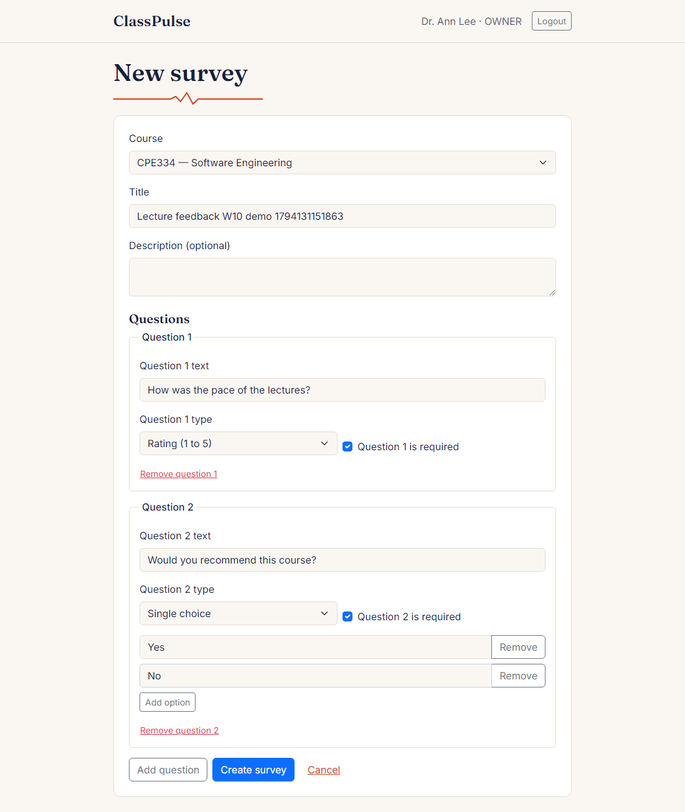
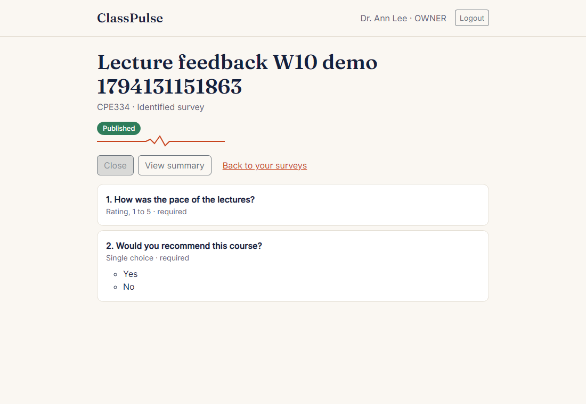
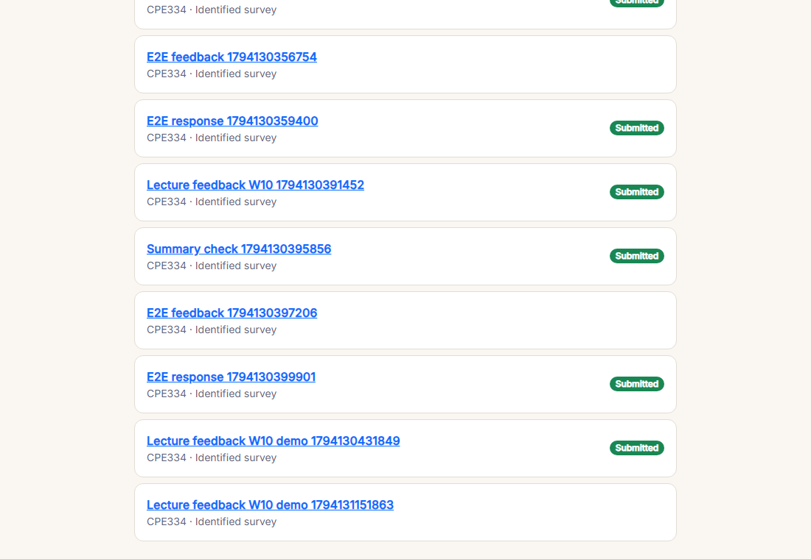
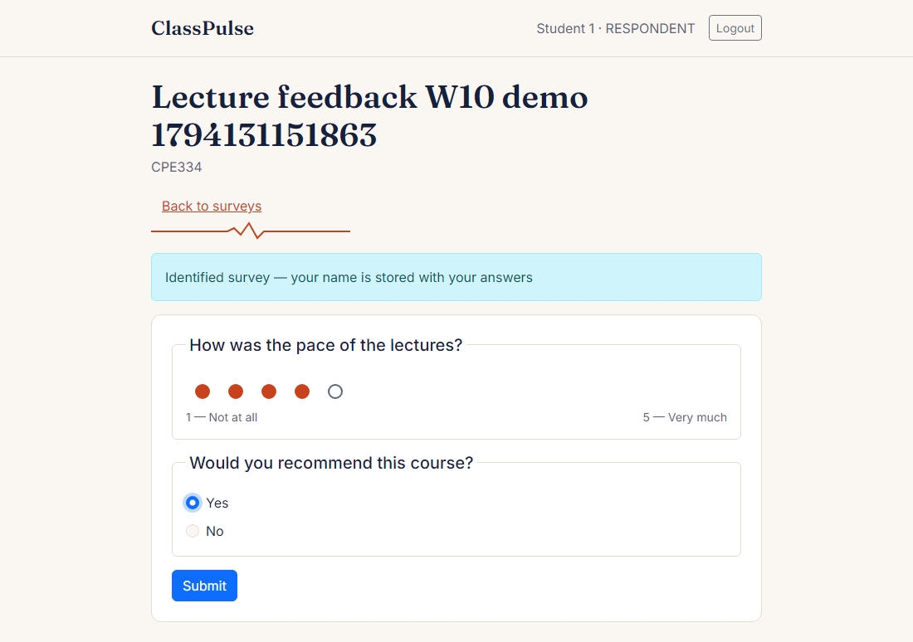
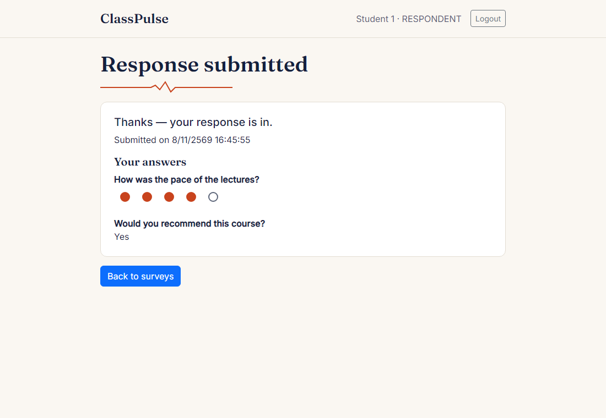

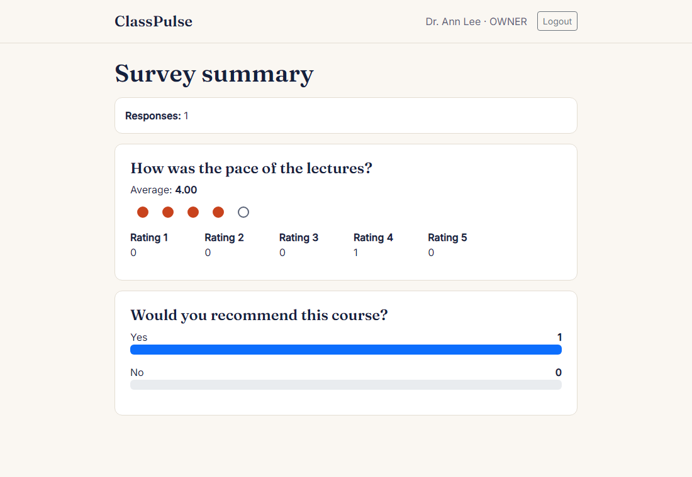

### DEMO-2 Business-rule rejections (F-04; AC-22, AC-23)

- **Role and start:** `student1`, who has already answered the demo survey; the seeded CLOSED survey "Week 1 pulse".
- **Steps:** the student answers the same survey again; the student opens "Week 1 pulse" and the same kind of request is sent to the API directly.
- **Expected:** the second answer is rejected with 409 `ALREADY_RESPONDED` and the page shows the server's message; the closed survey is not offered to the student (the page says "Survey not found") and a direct submission gets 409 `SURVEY_NOT_OPEN`.
- **Actual:** as expected; the codes and statuses are in the API log.

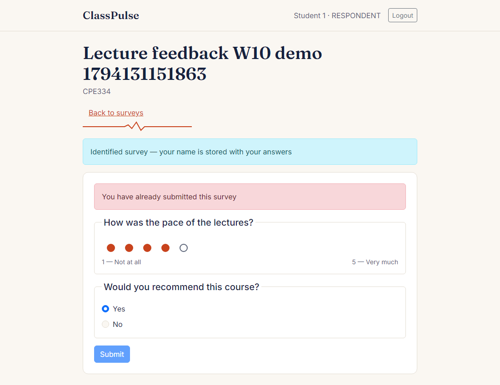
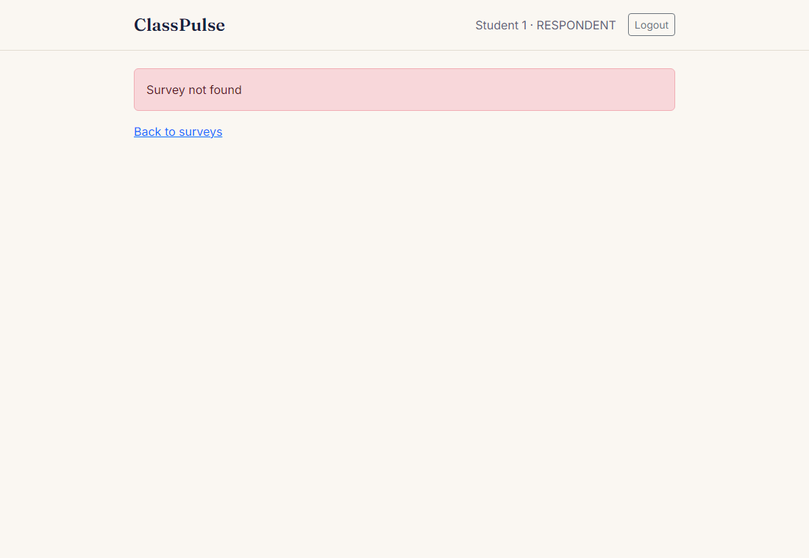

### DEMO-3 Login, logout and forbidden operations (F-01, F-03, F-05; AC-01, AC-04, AC-16, AC-32)

- **Role and start:** no session; `student1`, `ann.lee` and `ben.kim` (owner of CPE231, not of the demo survey).
- **Steps:** sign in with a wrong password; sign in correctly (the navbar shows name and role); log out; replay the logged-out session cookie against `/api/auth/me`; the student sends `POST /api/owner/surveys`; the other owner opens the demo survey's summary page and requests it from the API.
- **Expected:** the wrong password shows an error; the replayed cookie gets 401 `UNAUTHENTICATED`; the student gets 403 `FORBIDDEN`; the other owner gets 404 `NOT_FOUND`.
- **Actual:** as expected; statuses and bodies are in the API log. The automated counterparts are TEST-07, TEST-18, TEST-19 and TEST-36 in the table of F.4.

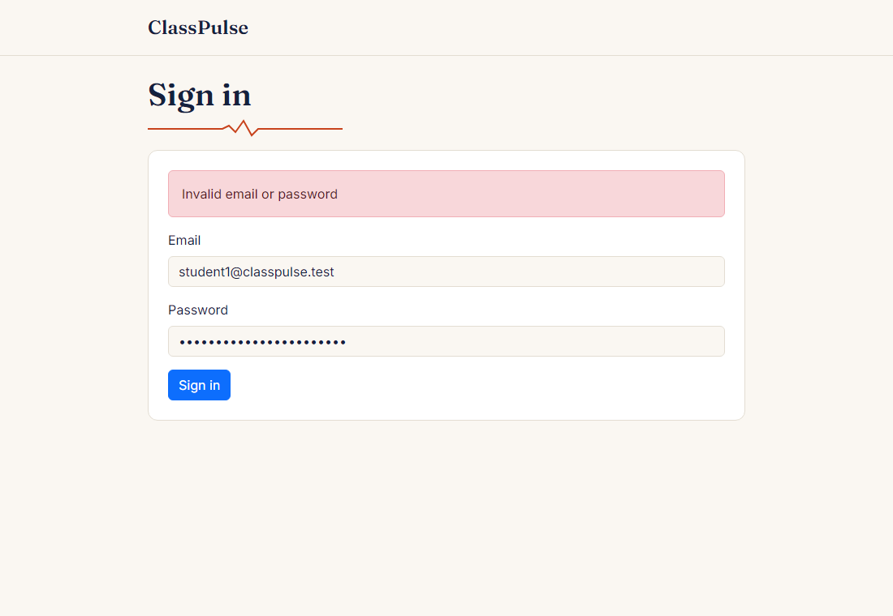
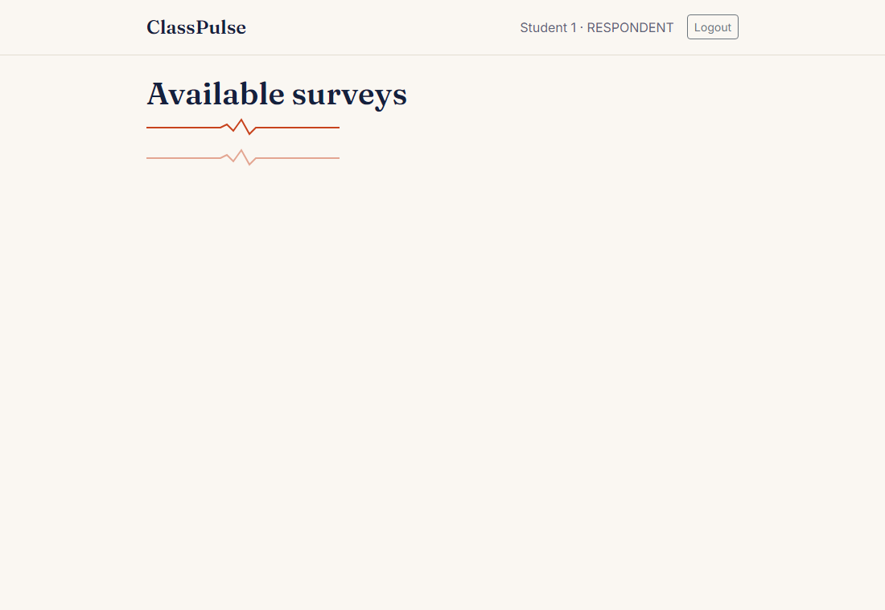
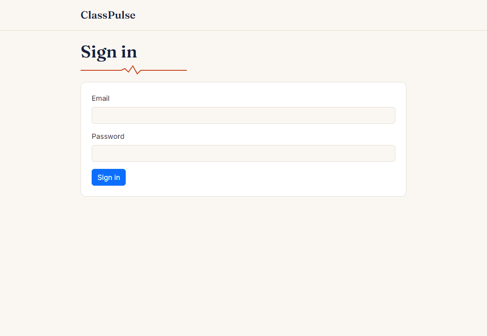
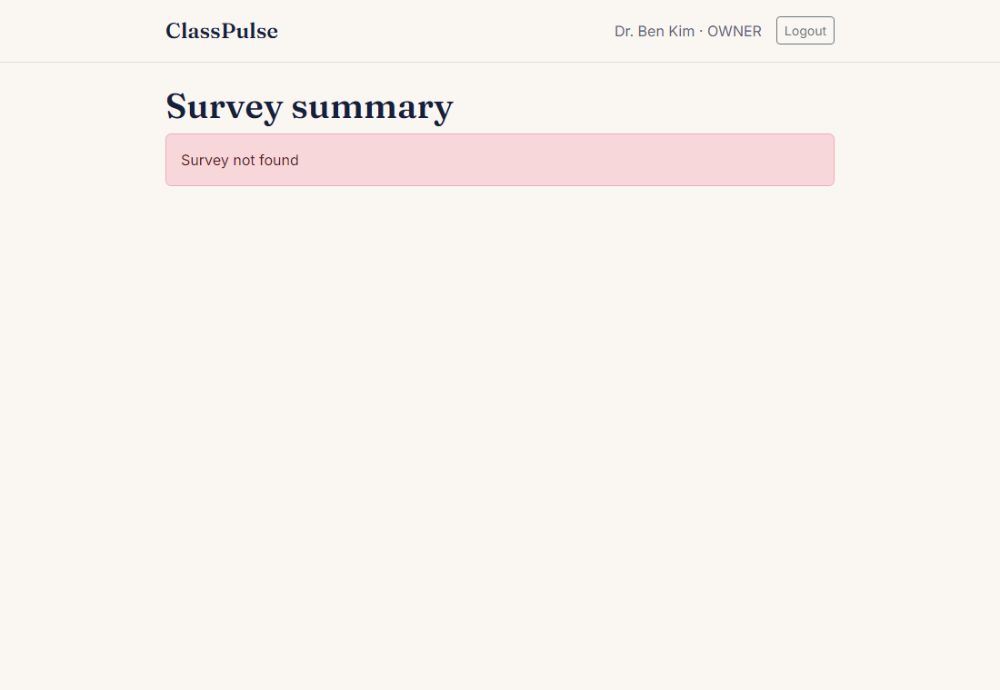

## F.3 Build and test results

Run in a clean clone checked out at the tag (`git checkout v1.0.0-sprint1`, tree clean), with the development and test databases created and seeded as in the README (PowerShell, Node v24.19.0, PostgreSQL 18, Python 3.14.6). Commit tested: `d4bad74211729032697164f378638efb834a67b6`. The full raw output, with local paths replaced by `<repo>`, is in `docs/sprints/sprint-1/evidence/release-server.txt`, `release-client.txt` and `release-e2e.txt`; the summary lines of each are quoted here.

| Command | Passed | Failed | Skipped | Exit | Output |
|---|---|---|---|---|---|
| `npm --prefix server run build && npm --prefix server run test` | 101 | 0 | 0 | 0 | `release-server.txt` |
| `npm --prefix client run build && npm --prefix client run test` | 1 | 0 | 0 | 0 | `release-client.txt` |
| `npm run test:e2e` | 8 | 0 | 0 | 0 | `release-e2e.txt` |
| `python tools/test_results.py` | 110 executed tests in total | 0 | 0 | 0 | `docs/sprints/sprint-1/test-results.md` |

```text
Server - Command: npm --prefix server run build && npm --prefix server run test
  Exit code: 0
  Test Files  12 passed (12)
  Tests  101 passed (101)

Client - Command: npm --prefix client run build && npm --prefix client run test
  Exit code: 0
  Test Files  1 passed (1)
  Tests  1 passed (1)

Playwright - Command: npm run test:e2e
  Exit code: 0
  8 passed (27.8s)
```

The generator printed `Overall result: PASSED`: every runner exited 0, every planned test and every one of the 39 acceptance criteria has an executed test. It also exits 1 and says FAILED when the contrary holds; that behaviour is tested in `tools/test_test_results.py` and was shown with an unimportable test file in `docs/sprints/sprint-1/evidence/I-10-results-tool-fresh-clone.txt`.

## F.4 Acceptance criteria to tests

See the AC → test → result table in `docs/sprints/sprint-1/test-results.md` (automated tests and manual checks are labelled separately). The generator that writes it exits 1 and says FAILED at the top if any test fails or is skipped, a planned test did not run, or an acceptance criterion has no executed test.

## F.5 Two test excerpts with TDD evidence

### Domain rule - TEST-25, simultaneous submissions store exactly one response (F-04, BR-06)

From `server/tests/api/responses.test.ts`:

```ts
test("TEST-25 simultaneous submissions store exactly one response", async () => {
  const survey = await makeSurvey({ course: f.cpe334, owner: f.owner1 });
  const agent = await loginAs(app, "student1@classpulse.test");
  const body = validAnswers(survey);
  const [r1, r2] = await Promise.all([
    agent.post("/api/surveys/" + survey.id + "/responses").send(body),
    agent.post("/api/surveys/" + survey.id + "/responses").send(body)
  ]);
  expect([r1.status, r2.status].sort()).toEqual([201, 409]);
  expect(await prisma.response.count({ where: { surveyId: survey.id } })).toBe(1);
});
```

- **Why it can fail:** the check is the database unique constraint `(surveyId, respondentId)`, mapped from Prisma `P2002` to 409 `ALREADY_RESPONDED`; a pre-check in code would let both requests through.
- **Red:** commit `588981c` (contract v1.1 `570b739` came first); `docs/sprints/sprint-1/evidence/F-04-red.txt` line 18: `× F-04 response submission > TEST-25 simultaneous submissions store exactly one response 139ms`.
- **Green:** commit `1448c15`; `docs/sprints/sprint-1/evidence/F-04-green.txt` line 16: `✓ ... TEST-25 simultaneous submissions store exactly one response 398ms`, then five focused repeats. At review, A also ran TEST-25 five times in a row (5 of 5 passed) and broke the code on purpose (the `P2002` mapping removed): TEST-24 and TEST-25 failed.

### Ownership restriction - TEST-19, another owner cannot publish my survey (F-03, BR-08)

From `server/tests/api/ownerSurveys.test.ts`:

```ts
test("TEST-19 another owner gets 404 reading, publishing or closing my survey and nothing changes", async () => {
  const draft = await makeSurvey({ course: f.cpe334, owner: f.owner1, status: "DRAFT" });
  // Positive control: the real owner can read it, so the 404s below come from ownership, not a missing route.
  const own = await (await ownerAgent()).get(`/api/owner/surveys/${draft.id}`);
  expect(own.status).toBe(200);
  expect(own.body.survey.id).toBe(draft.id);

  const other = await otherOwnerAgent();
  for (const res of [
    await other.get(`/api/owner/surveys/${draft.id}`),
    await other.post(`/api/owner/surveys/${draft.id}/publish`),
    await other.post(`/api/owner/surveys/${draft.id}/close`)
  ]) {
    expect(res.status).toBe(404);
    expect(res.body.error.code).toBe("NOT_FOUND");
  }
  const row = await prisma.survey.findUniqueOrThrow({ where: { id: draft.id } });
  expect([row.status, row.publishedAt, row.closedAt]).toEqual(["DRAFT", null, null]);
  expect((await other.get("/api/owner/surveys/abc")).status).toBe(404);
});
```

- **Why it can fail:** every route filters by the signed-in owner; remove that filter and another owner can read, publish or close the survey.
- **Red:** commit `255cde6` had this test passing before any route existed (a missing route is also a 404), so the positive control was added in `bc3b59f` and the run repeated: in `docs/sprints/sprint-1/evidence/F-03-red.txt` (stage 2), the 10 tests of `ownerSurveys.test.ts` including TEST-19 fail with `expected 404 to be 200`. Contract v1.1 is `e05a509`.
- **Green:** commit `8337e09`; `docs/sprints/sprint-1/evidence/F-03-green.txt` records the stage 2 green run and the mutation check "read a survey without the ownership filter -> TEST-19 fails".

## F.6 Two Issue and PR chains

Two completed Issues, one per student, followed from the Issue to the release.

### Chain 1 - Issue #7, F-03 survey authoring (author Punge089, reviewer book6349)

- **Issue #7** (I-07, F-03, AC-10…AC-19) → contract v1.0 `01117e4`, v1.1 `e05a509` (after the contract review by book6349) → branch `feature/7-survey-authoring` → red and green commits (F.7) → **pull request #18** into `sprint-1-staging`, opened by Punge089, reviewed by book6349 → merge commit `ae744c2` → release pull request #27 into `main` (merge `d4bad74`) → tag `v1.0.0-sprint1`.
- **Substantive review** (book6349, approved after running the code): "Fresh clone at `316fa81`. Server tests → 63 passed, 0 failed, 0 skipped; client → 1 passed, 0 failed, 0 skipped; Playwright → 5 passed, 0 failed, 0 skipped. Both builds passed. I-07 `pr_check`: publishing the seeded CLOSED survey returned 409 `INVALID_TRANSITION`, and its database status remained CLOSED. I checked TEST-11 against the AC-11 invalid-input cases and verified the owner scoping on route reads and writes. […]" Inline on `server/src/routes/ownerSurveys.ts:82`: "This `ownerId` filter scopes `GET /api/owner/surveys` to the caller; checked against AC-18/TEST-20 and the list test, this matches."

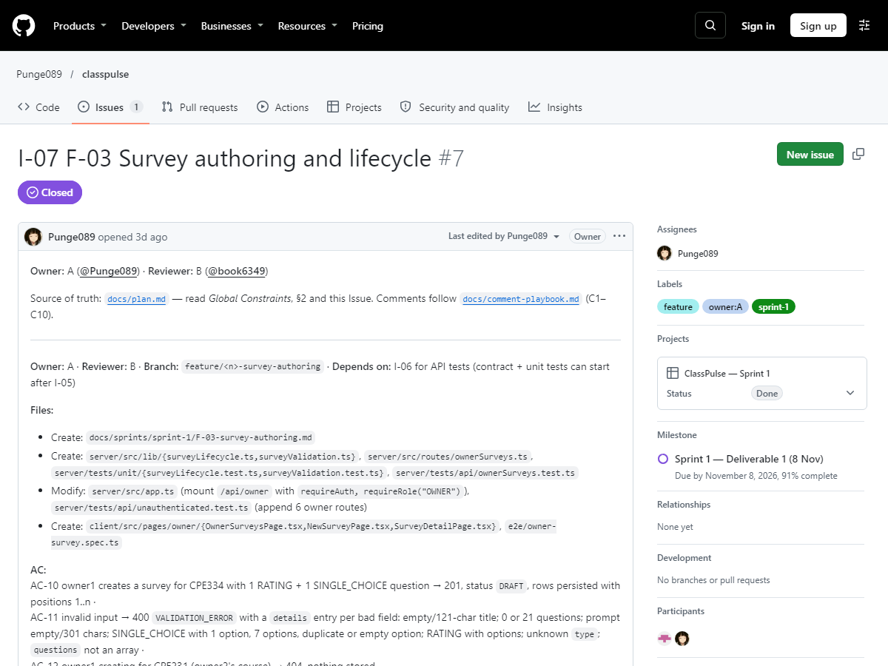
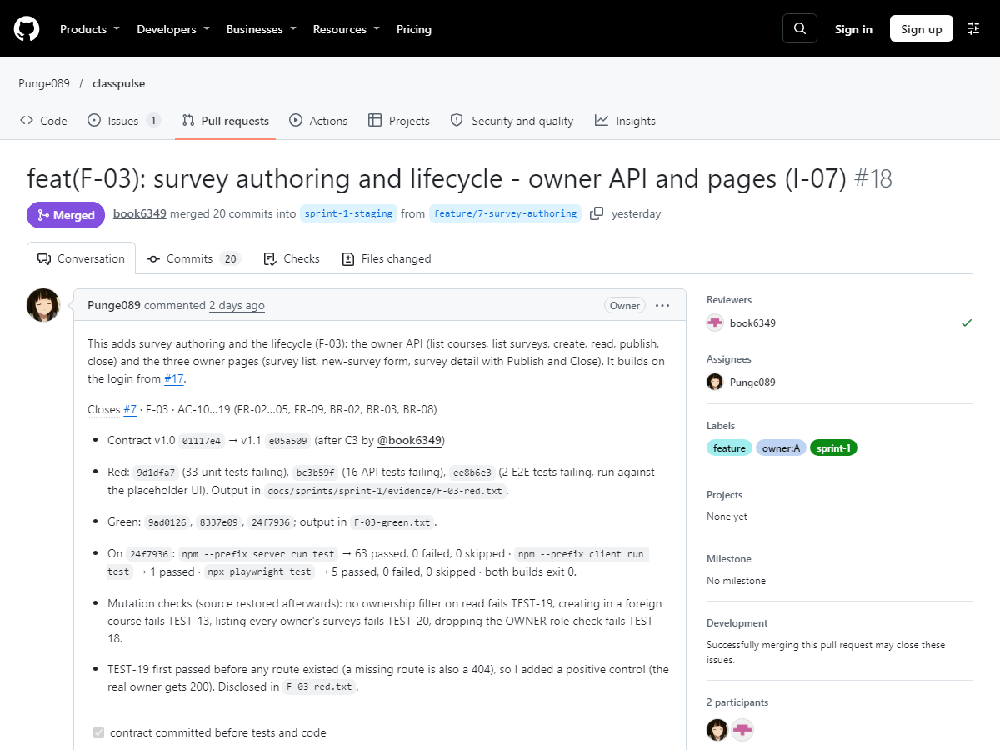

### Chain 2 - Issue #8, F-04 response submission (author book6349, reviewer Punge089)

- **Issue #8** (I-08, F-04, AC-20…AC-29) → contract v1.0 `5862052`, v1.1 `570b739` (after the contract review by Punge089) → branch `feature/8-response-submission` → red and green commits (F.7) → **pull request #21** into `sprint-1-staging`, opened by book6349, reviewed by Punge089 → merge commit `c1823f5` → release pull request #27 into `main` (merge `d4bad74`) → tag `v1.0.0-sprint1`.
- **Substantive review** (Punge089, approved after running the code and breaking it on purpose): "Pulled 328e077 (up to date with staging 8c4323f) and ran: server 91 passed, 0 failed, 0 skipped; client 1 passed, 0 failed, 0 skipped; npm run test:e2e 6 passed, 0 failed, 0 skipped; both builds exit 0; […] pr_check: TEST-25 five times in a row, 5/5 passed. In the UI the CLOSED seed survey "Week 1 pulse" is not listed for student1, /surveys/1 shows "Survey not found" with no form or Submit, and a direct POST returns 409 SURVEY_NOT_OPEN. I also broke five rules on purpose (status before enrollment, response ownership filter, PUBLISHED filter, rating bound, P2002 mapping) and each time the matching tests failed (TEST-27, 30, 22, 28+29, 24+25), then restored. […]"

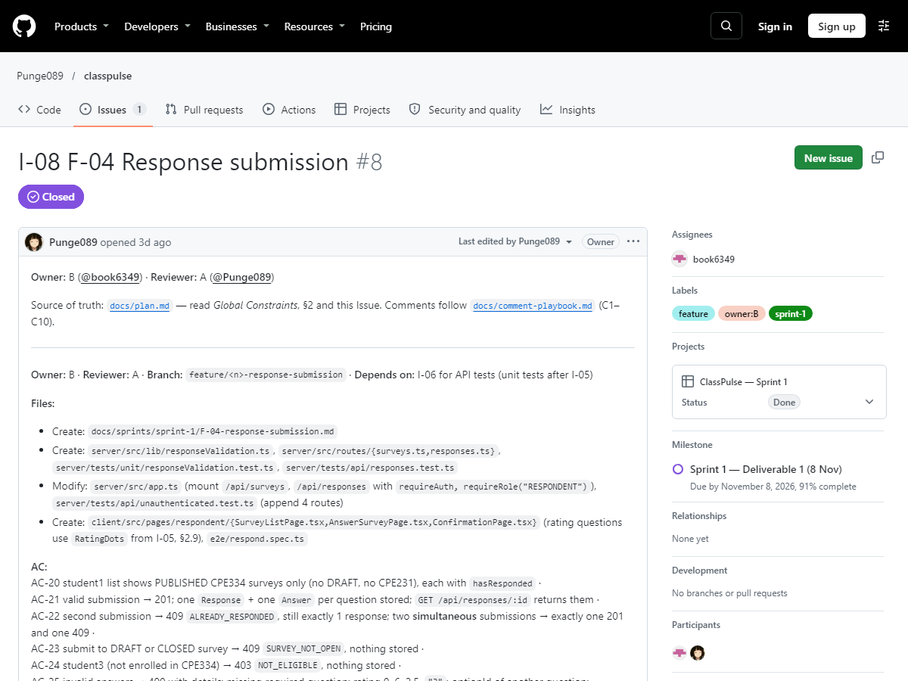
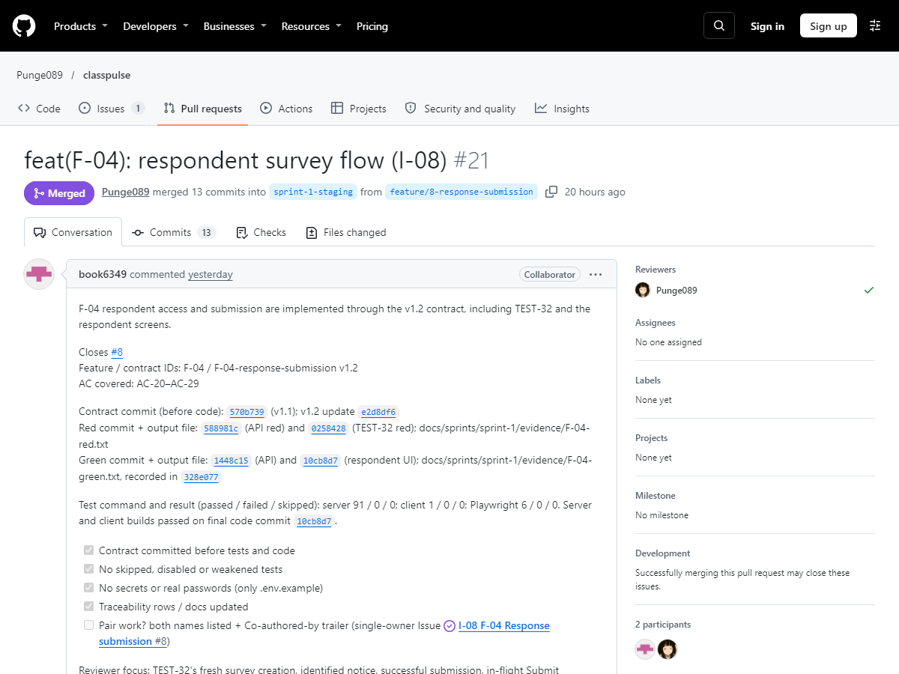

### Release and board

- **Release pull request #27** (`sprint-1-staging` → `main`), opened by Punge089, reviewed and merged by book6349, merge commit `d4bad74`; the annotated tag `v1.0.0-sprint1` (tag object `7f2a63d`) was pushed by book6349 on that commit. The review found the secret-scan note wrong (7 matches, not 5) and the note was corrected before the merge.
- **Project board** (public, https://github.com/users/Punge089/projects/5): all eleven Issues; #1 to #10 are Done and #11 is In progress at the time of writing. The screenshot below was captured early on 8 Nov (01:34, UTC+7), when #1 was still In progress; Issue #1 was closed by book6349 and set to Done later that day. A second capture failed because GitHub answered HTTP 504 for the board page.

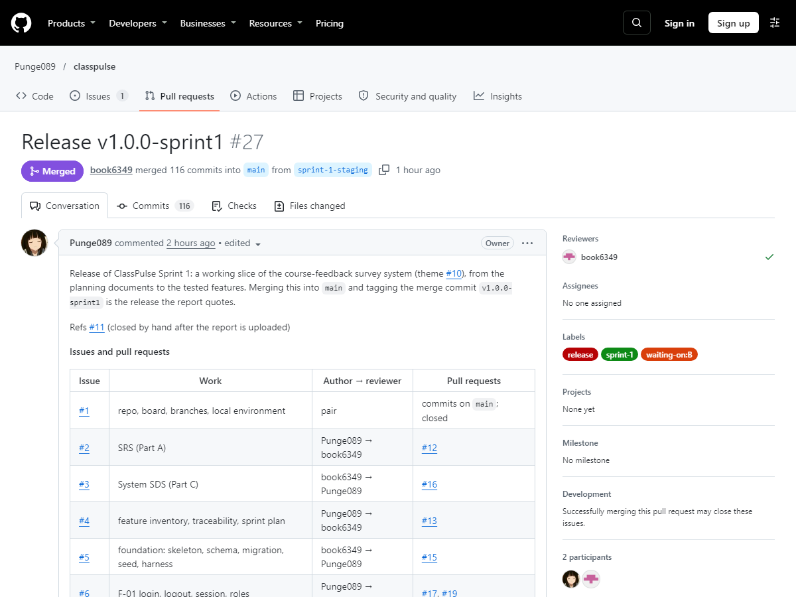
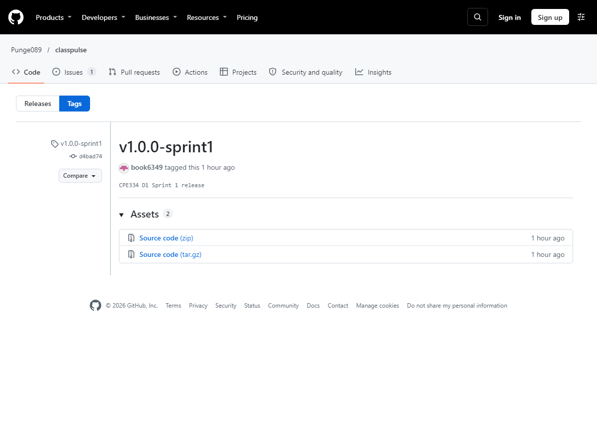
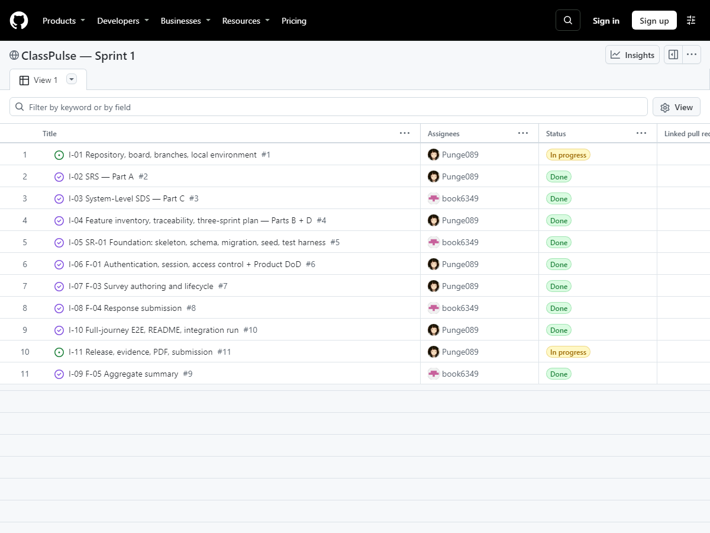

## F.7 History sequence

`git log --date=iso-strict --format="%h  %ad  %an  %s"` for the commits named below. For F-03 the order is contract (v1.0, v1.1) → red → green, in three stages (unit rules, API, UI); for F-04 it is contract (v1.0, v1.1) → red → green for the API, then red → green for the respondent pages.

```text
F-03 (Issue #7, branch feature/7-survey-authoring)
01117e4  2026-11-06T04:35:50+07:00  Punge089  docs(F-03): contract v1.0
e05a509  2026-11-06T21:20:52+07:00  Punge089  docs(F-03): contract v1.1 after C3 - plan-aligned 404/400 order, explicit TEST-11 cases
9d1dfa7  2026-11-06T21:37:25+07:00  Punge089  test(F-03): failing lifecycle and validation unit tests TEST-11, TEST-15 with stubs (red)
9ad0126  2026-11-06T21:38:30+07:00  Punge089  feat(F-03): survey status transitions and create-survey validation (green, stage 1)
255cde6  2026-11-06T23:02:12+07:00  Punge089  test(F-03): failing API tests TEST-10, 12-14, 16-20 and the owner routes in TEST-07 (red, stage 2)
bc3b59f  2026-11-06T23:02:35+07:00  Punge089  test(F-03): TEST-19 positive control so the 404 proves ownership, not a missing route (red)
8337e09  2026-11-06T23:04:20+07:00  Punge089  feat(F-03): owner survey routes - create, list, read, publish, close (green, stage 2 API)
ee8b6e3  2026-11-06T23:05:53+07:00  Punge089  test(F-03): failing E2E TEST-21 for owner survey create and publish (red)
24f7936  2026-11-06T23:06:54+07:00  Punge089  feat(F-03): owner pages - survey list, new survey form and survey detail with publish and close (green, UI)

F-04 (Issue #8, branch feature/8-response-submission)
5862052  2026-11-06T21:51:46+07:00  book6349  docs(F-04): contract v1.0
570b739  2026-11-06T22:21:35+07:00  book6349  docs(F-04): incorporate C3 into contract v1.1
588981c  2026-11-06T23:35:44+07:00  book6349  test(F-04): failing response rule tests (red)
1448c15  2026-11-07T00:13:34+07:00  book6349  feat(F-04): implement response API and validation
0258428  2026-11-07T19:14:34+07:00  book6349  test(F-04): add failing TEST-32 respondent journey
10cb8d7  2026-11-07T19:21:14+07:00  book6349  feat(F-04): implement respondent survey flow
```

## F.8 Contributions

See `docs/contributions.md`.

## F.9 AI use

See `docs/ai-use.md`.

## F.10 Known limitations, failed and skipped tests

- Failed or skipped tests in the release runs: none. The release run shows 0 failed and 0 skipped for the server tests (101), the client tests (1) and the Playwright tests (8) in `release-server.txt`, `release-client.txt` and `release-e2e.txt`, and the generator exits 0.
- Only Sprint 1 is implemented: FR-10…FR-18, BR-01, BR-11…BR-14, NFR-06, NFR-08 and NFR-10 are planned for Sprint 2 and 3 (`docs/sprints/plan.md`); their rows in the traceability matrix say "not run yet".
- NFR-05 (data survives a restart) and NFR-09 (no secrets in the repository) are manual checks in Sprint 1: NFR-05 is DEMO-1 above, NFR-09 is the secret scan on the release pull request. NFR-07 (loading, empty and error states) is covered by the automated tests of the screens plus a manual checklist.
- There is no automated test for two simultaneous publish or close requests on one survey (the transition is a conditional update, but no test races it).
- There is no delete route for surveys or responses in Sprint 1, so the E2E runs leave surveys in the development database.
- Docker, continuous integration and the cloud deployment are Lab 5, not part of this release.
- Process notes: PR #17 was merged by its own author after the reviewer's approval (see `docs/contributions.md`); a duplicated test ID (TEST-20) was found in review and renumbered (TEST-58, TEST-21a/b); the stage 1 red output of F-03 lacks the closing vitest summary lines because the capture was cut short, which the file itself says; `docs/sprints/sprint-1/evidence/F-05-green.txt` is a typed summary, the raw output of the same runs is in `integration-server.txt` and `release-server.txt`; commits by Student B carry no `Co-Authored-By` trailer (see `docs/ai-use.md`).
