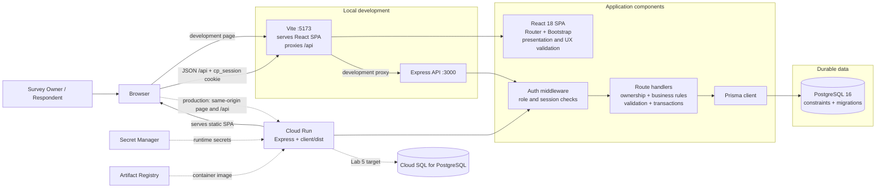

# ClassPulse component and deployment view

The dashed production links are the planned Lab 5 deployment. In production the browser uses the Cloud Run origin for both the static SPA and `/api`; the Vite proxy exists only during development. The route handler and database paths shown are the designed Sprint 1 responsibilities, with API routes added by the feature Issues.
