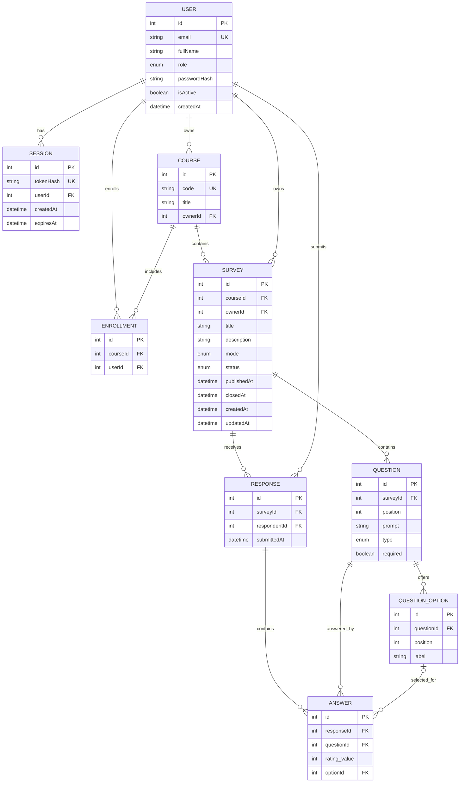

# ClassPulse Sprint 1 ER diagram

Sprint 1 ownership is explicit in both `SURVEY.ownerId` and `COURSE.ownerId`; the API checks they identify the same owner. `RESPONSE.respondentId` keeps responses identified. Composite unique constraints are `ENROLLMENT(courseId, userId)`, `QUESTION(surveyId, position)`, `QUESTION_OPTION(questionId, position)`, `RESPONSE(surveyId, respondentId)` and `ANSWER(responseId, questionId)`. PostgreSQL also has `CHECK (rating_value IS NULL OR rating_value BETWEEN 1 AND 5)` on `ANSWER`; its migration name is `answer_rating_range`. Sprint 2/3 planned entities (`Section`, `ParticipationRecord`, `AnonymousResponse`) are intentionally omitted from this Sprint 1 ER diagram; `AnonymousResponse` is planned without a user foreign key.
