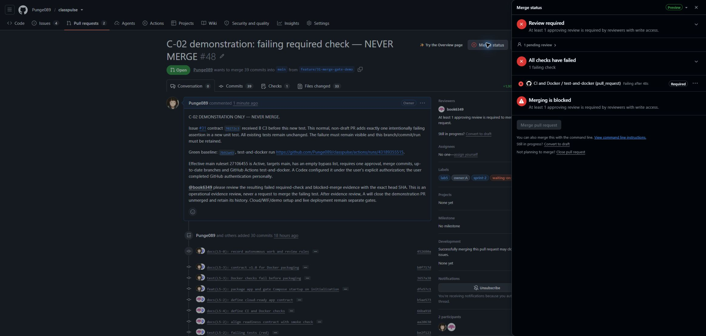
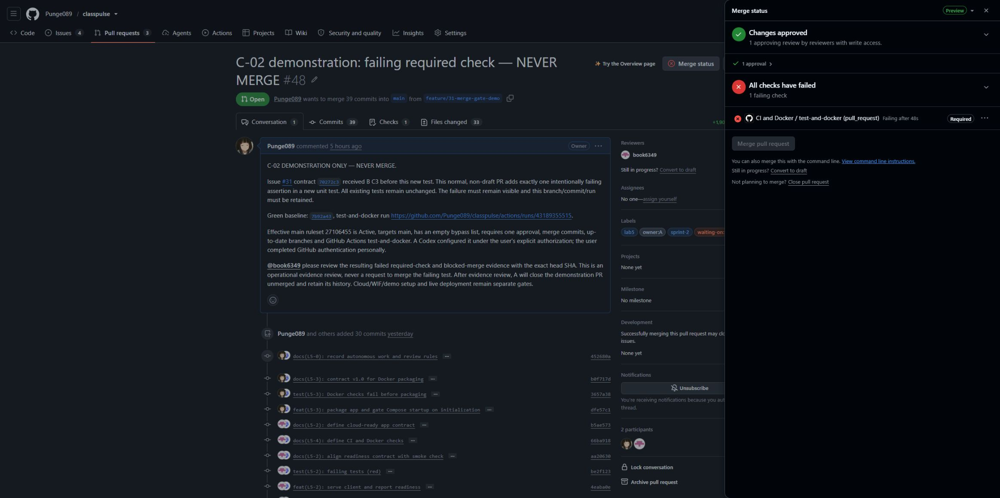

# C-02 required-check demonstration

Issue #31, contract 70272c3. B approved C3 before the demonstration test. Evidence collected 12 November 2026.

## Effective protection

A explicitly authorized Codex to configure main protection through the signed-in browser, superseding the earlier human-only boundary for this specific setting. A personally completed GitHub Confirm access. Codex verified saved active ruleset [27106455](https://github.com/Punge089/classpulse/settings/rules/27106455), `main-reviewed-ci`, through both the ruleset and effective-main-rules APIs.

- Target: `refs/heads/main`; enforcement active; bypass actors empty.
- One approving PR review; stale approvals dismissed after new commits; merge commits only.
- Required check: `test-and-docker`, GitHub Actions integration 15368.
- Strict up-to-date checks, deletion protection and force-push protection enabled.
- Cloud resources, WIF and the `demo` environment remain separately unverified. Main protection alone does not authorize a live deployment.

Readback commands:

```sh
gh api repos/Punge089/classpulse/rulesets/27106455
gh api repos/Punge089/classpulse/rules/branches/main
gh pr checks 48 --required
gh pr view 48 --json headRefOid,isDraft,mergeable,mergeStateStatus,statusCheckRollup
```

## Baseline and intentional failure

- Baseline source: `7b92a43b80861271a2826f45679bd41881af91c5`; [green run 43189355515](https://github.com/Punge089/classpulse/actions/runs/43189355515).
- Demonstration: [normal non-draft PR #48](https://github.com/Punge089/classpulse/pull/48), branch `feature/31-merge-gate-demo`, targets main.
- Exact head: `bad1b85aabb9fc69679a856cd81621bfa4ede45a`.
- The only change relative to the accepted staging baseline is one new file, `server/tests/unit/lab5MergeGateDemo.test.ts`, containing one deliberately failing assertion. No existing test changed.
- [Failed run 43196454571](https://github.com/Punge089/classpulse/actions/runs/43196454571), job `test-and-docker`, ran the complete server suite through `npm test` in `server/` (equivalent to `npm --prefix server run test`). Result: **105 passed, 1 failed, 0 skipped, 106 total**, across 14 passing files and one failing file.
- The sole failure is the deliberate comparison of `required-check-failed` with `required-check-passed`. Client tests, builds and Docker build did not execute after the server step failed; no green result is claimed for those steps in this failed run.

## Blocked state and remaining review

At that exact head, `gh pr checks 48 --required` reports the failed `test-and-docker`. The PR is non-draft, conflict-free (`MERGEABLE`) and has merge state `BLOCKED`. The browser labels the failed check **Required** and disables **Merge pull request**. The branch includes the current main ancestor and has no conflict/stale-branch issue in this observation.



The captured UI also reports the missing teammate approval. It does not prove the failed check was the only blocker. The effective required-check rule and the actual failed required check establish the check condition; B must review the evidence. If B approves this deliberate demonstration without merging, capture the resulting remaining check blocker before closing.

## Post-approval verification and unmerged close

B [approved the operational demonstration](https://github.com/Punge089/classpulse/pull/48#pullrequestreview-5876449358) at unchanged `bad1b85` on 12 November 2026 at 14:47:49 UTC. This approval was explicitly for C-02, not a release or permission to merge the deliberate failure.

After that approval, the browser showed **Changes approved**, one approving review, the failed **Required** `test-and-docker` check and a disabled **Merge pull request** button. The earlier missing-approval condition was gone. API readback reported `reviewDecision: APPROVED`, `mergeable: MERGEABLE`, and `mergeStateStatus: BLOCKED` at the same head. The failed required check therefore remained a blocker after review was satisfied, with no conflicts or outdated-main condition.



A closed PR #48 **unmerged** after capturing that state. Readback: `state: CLOSED`, `mergedAt: null`, `mergeCommit: null`, head `bad1b85aabb9fc69679a856cd81621bfa4ede45a`. Its branch, deliberately failing assertion, commit and failed run remain retained. Never merge this branch or change the assertion to green. This evidence PR contains no demonstration test.

C-02 observations and unmerged cleanup are complete; B's final review/merge of this updated evidence is pending. Issue #31 also tracks WIF and environment setup, which remain separate human gates and are not declared complete by this demonstration.
