# C-05 — restart and redeployment observed; rollback/forward pending

Issue [#32](https://github.com/Punge089/classpulse/issues/32), R-04 / NFR-05. A collects the evidence; B reviews it. Contract v1.0 at `8c82dee` received B's C3 before live checks. These are operational observations, not a new failing implementation or an automated test suite.

## Stable record and accepted release

Observed on 14 November 2026 (Asia/Bangkok). The synthetic record was created through the deployed UI after initialization; it is not the seeded survey. Its saved survey, response and aggregate values agree at baseline, after restart and after the separately reviewed main redeployment.

| Field | Stable record and initial release |
|---|---|
| Survey | ID **2**, `CPE334 Lab 5 deployment feedback - EN-034_P0 - 2026-11-14` |
| Course / status | CPE334 / Published; identified survey |
| Questions | Two required 1–5 ratings and one required single-choice question |
| Saved response | ID **1**, synthetic `student1@classpulse.test`; displayed submission time **11/14/2026, 1:56:02 AM** |
| Answers | Rating **4**, rating **5**, **Cloud deployment** |
| Owner aggregate | **1** response; averages **4.00 / 5.00**; Cloud deployment **1**, other choices **0** |
| Initial accepted main source | [`a63719dd823dd77c86fbf187b4bc6663b4e07d8b`](https://github.com/Punge089/classpulse/commit/a63719dd823dd77c86fbf187b4bc6663b4e07d8b) |
| Initial accepted main workflow | [43475436003](https://github.com/Punge089/classpulse/actions/runs/43475436003), successful |
| Initial image digest | `sha256:8b5d63ae5e29b373601908b0f0be9817461de8db466d8bf27f0a3b15288a6c09` |
| Baseline database attachment | `cpe-334-en-034:asia-southeast1:classpulse-pg` |

The runtime database attachment was established at baseline. The restart command changed only the nonsecret `LAB5_RESTART` variable; it did not select another image, database or secret version. After the separately reviewed main redeployment, A read the new revision's Cloud SQL Connections panel and confirmed the same attachment, as recorded below. No credential value or connection URL was opened.

## Guarded same-image restart and actual operator

The [prepared script and guards](https://github.com/Punge089/classpulse/issues/32#issuecomment-6862573365) checked the live latest-ready revision and its resolved image digest before any update. Expected baseline: `classpulse-00002-54d` and the digest above. Both guards passed. The mutating command was:

```bash
gcloud run services update "$SERVICE" --project "$PROJECT_ID" --region "$REGION" \
  --update-env-vars "LAB5_RESTART=$(date -u +%Y%m%dT%H%M%SZ)" --quiet >/dev/null
```

The reviewed script supplies `SERVICE=classpulse`, `PROJECT_ID=cpe-334-en-034` and `REGION=asia-southeast1`, and runs in Bash with `set -euo pipefail` and `set +x`. It then reads the ready revision and digest, asserts a new revision and identical image, and prints traffic metadata. Do not rerun it with its old baseline after this successful operation.

**Operator exception:** the original contract required a human to run cloud mutations. After the prepared command and that boundary were explained, A directly requested Codex perform this specific restart. A's Codex executed the script through A's browser Cloud Shell as `punge089@gmail.com`. This was an agent-executed mutation under that specific user override, not a human-run command or a new pre-operation teammate C3 approval. The actual actor is recorded in [the result comment](https://github.com/Punge089/classpulse/issues/32#issuecomment-6873806997) and the scoped AI-use follow-up [PR #56](https://github.com/Punge089/classpulse/pull/56). The contract's acceptance criteria were not weakened; future direct cloud operations retain their human boundary unless separately authorized by the user.

| Observation | Before restart | After restart |
|---|---|---|
| Ready / serving revision | `classpulse-00002-54d` | **`classpulse-00003-5jd`** |
| Resolved image digest | `sha256:8b5d63ae5e29b373601908b0f0be9817461de8db466d8bf27f0a3b15288a6c09` | **Identical digest** |
| Traffic on observed revision | 100% | **100%** |
| Source image | Accepted main `a63719d` | **Same accepted main image** |
| Survey / response / aggregate | Survey 2 and response 1 as above | **Reread separately as owner and respondent; values agree** |

Cloud Run reported revision creation and traffic routing successful. A Cloud Shell session transfer interrupted the first observation; Codex reconnected to read the completed result and did not rerun the mutation. A privately signed in as owner and respondent for the UI readbacks. Codex inspected no passwords, cookies, tokens or secret values, and submitted no new answer during this verification.

The public read-only command `python -B deploy/smoke_test.py https://classpulse-zdwglar6eq-as.a.run.app/` passed **4/4** checks after the restart: health, database readiness, ClassPulse home, and the unauthenticated access boundary. This is a live smoke result for the unchanged `a63719d` image, not a rerun of the complete unit suite on the evidence commit.

## Separately reviewed main redeployment

B approved the updated release [PR #58](https://github.com/Punge089/classpulse/pull/58) at `43df7a7f34a0da3d8808138bf401c54e5c418550` on 14 November at 10:32:55 UTC, then merged it at 10:33:19 UTC. This is distinct from the earlier same-image restart.

| Redeployment observation | Actual result |
|---|---|
| Accepted main merge | [`1fe3e3b82dfb0537be30223c9b598b3479b4affe`](https://github.com/Punge089/classpulse/commit/1fe3e3b82dfb0537be30223c9b598b3479b4affe) |
| Main workflow | [43585838076](https://github.com/Punge089/classpulse/actions/runs/43585838076), successful CI and deploy jobs; WIF, migration/service update and smoke succeeded |
| Source CI | `npm test` in server: 105 passed in 14 files; client: 1 passed; 0 failed or skipped; both builds and Docker build passed |
| Registry identity | Full-SHA tag `1fe3e3b82dfb0537be30223c9b598b3479b4affe` resolves to `sha256:60f61ccccbc559e6c060383ad9acafc6918e1202ec1e7e5e43aa107c35707795` |
| Serving revision / traffic | **`classpulse-00004-lzd`, 100% to latest**; previous `classpulse-00003-5jd` has 0% |
| Actual revision image | **Same `sha256:60f61ccccbc559e6c060383ad9acafc6918e1202ec1e7e5e43aa107c35707795` digest**, read from the serving revision, rather than inferred from its tag |
| Database attachment | **`cpe-334-en-034:asia-southeast1:classpulse-pg`**, read in the new revision's Cloud SQL Connections panel; matches baseline |
| Direct response readback | Reloaded `/responses/1` in the signed-in respondent session after deployment: original 1:56:02 AM timestamp, ratings 4/5 and Cloud deployment retained |
| Owner readback | After human private owner sign-in: survey 2 remains Published with the original three questions; count 1, averages 4.00/5.00, Cloud deployment 1 and other choices 0 |
| Additional public smoke | `python -B deploy/smoke_test.py https://classpulse-zdwglar6eq-as.a.run.app/` passed **4/4**, 0 failed, against this deployed main image |

A used browser DOM controls for these live readbacks and saved Figures C-05.7–C-05.11. No new survey or response was created during verification. The workflow performed deployment after B's reviewed merge; A did not dispatch a restart, rollback or roll-forward in this phase. These redeployment observations await B's evidence review.

Both accepted main versions have identical application, Prisma schema/migrations/seed, Docker and deployment-workflow source. Their two full-SHA image tags were observed in Artifact Registry. These are the compatibility facts for a later human-reviewed rollback/forward; they do not establish that either operation has run.

## Numbered figures and direct page URLs

The application figures are original browser viewport captures of synthetic data. Their address bars are outside the captured viewport; the observed page URL is supplied in each caption rather than added to the image. B reviewed Figures C-05.1–C-05.6 and their context/readability in [PR #57](https://github.com/Punge089/classpulse/pull/57) before merging the restart evidence. New redeployment Figures C-05.7–C-05.11 await B review. The final report must retain these readable URL captions and receive both students' layout/content review.

**Figure C-05.1 — baseline response 1 before restart.** Page: [saved response](https://classpulse-zdwglar6eq-as.a.run.app/responses/1); ratings 4/5 and Cloud deployment, with the original submission time.

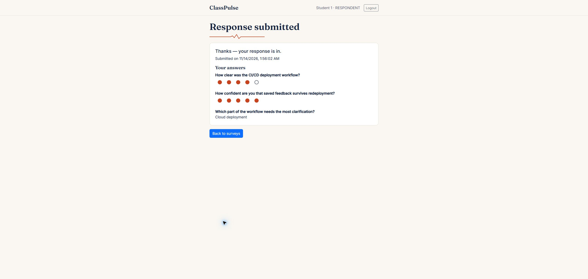

**Figure C-05.2 — baseline owner summary before restart.** Page: [survey 2 summary](https://classpulse-zdwglar6eq-as.a.run.app/owner/surveys/2/summary); response count 1, averages 4.00/5.00 and Cloud deployment 1.

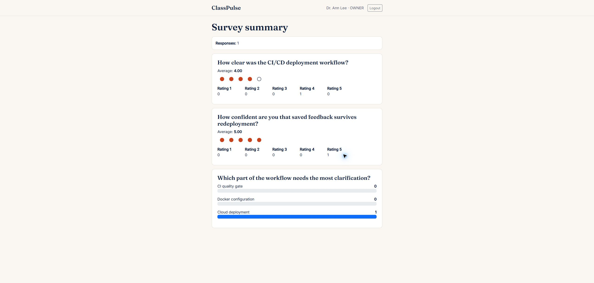

**Figure C-05.3 — guarded restart output.** [Project Console](https://console.cloud.google.com/run/detail/asia-southeast1/classpulse/revisions?project=cpe-334-en-034); the actual Cloud Shell output shows distinct revisions, unchanged resolved image and 100% traffic. The service URL is also visible in the output. The script's original human-operator comment predates the specific user override described above.

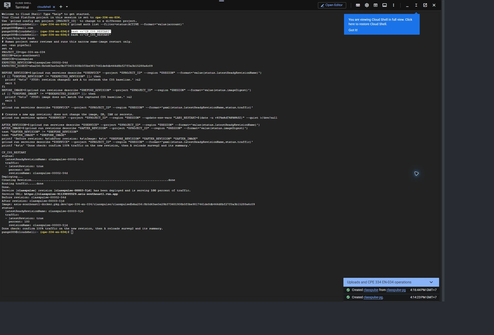

**Figure C-05.4 — survey 2 after restart.** Page: [survey 2](https://classpulse-zdwglar6eq-as.a.run.app/owner/surveys/2); original title, Published status and three questions retained.

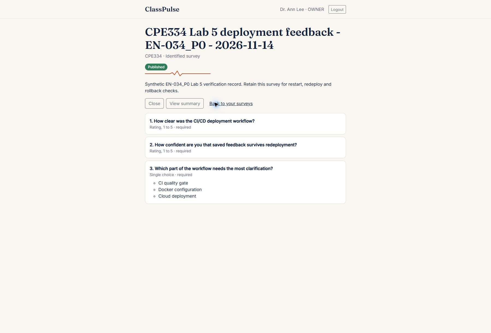

**Figure C-05.5 — owner summary after restart.** Page: [survey 2 summary](https://classpulse-zdwglar6eq-as.a.run.app/owner/surveys/2/summary); the values match Figure C-05.2.

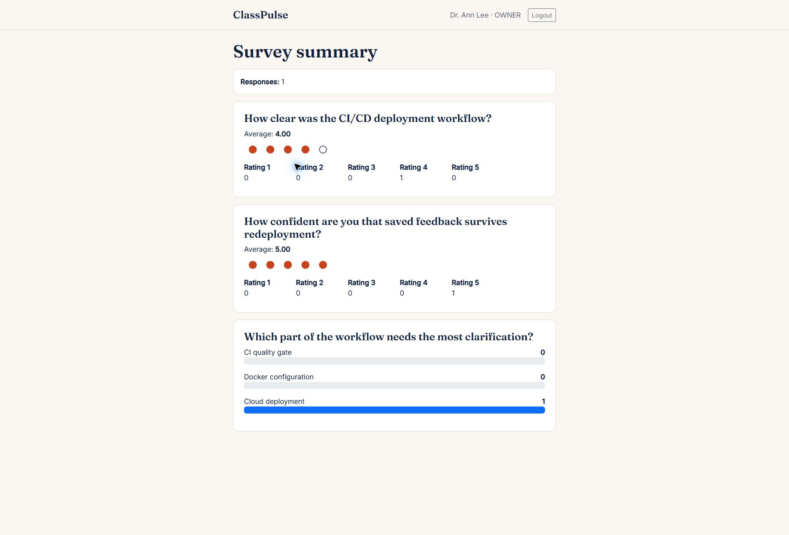

**Figure C-05.6 — direct response 1 after restart.** Page: [saved response](https://classpulse-zdwglar6eq-as.a.run.app/responses/1); respondent readback retains the same timestamp, ratings and choice as Figure C-05.1. This is a read of the saved response, not a fresh submission.

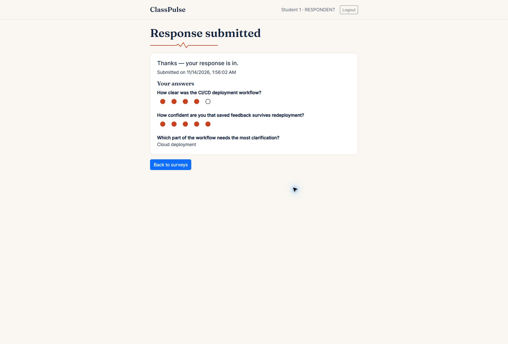

**Figure C-05.7 — accepted second-main image tag.** [Artifact Registry](https://console.cloud.google.com/artifacts/docker/cpe-334-en-034/asia-southeast1/classpulse/classpulse?project=cpe-334-en-034) maps full SHA `1fe3e3b82dfb0537be30223c9b598b3479b4affe` to digest `60f61ccccbc559e6c060383ad9acafc6918e1202ec1e7e5e43aa107c35707795`.

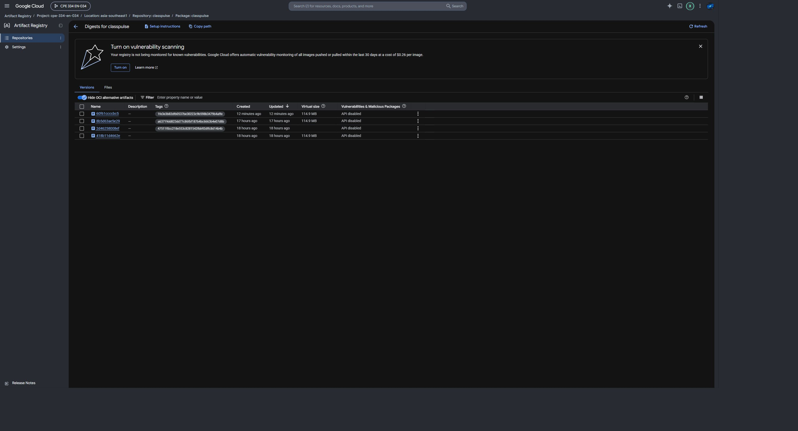

**Figure C-05.8 — serving revision and unchanged database attachment.** [Cloud Run revision history](https://console.cloud.google.com/run/detail/asia-southeast1/classpulse/revisions?project=cpe-334-en-034) shows `classpulse-00004-lzd` at 100% and the same Cloud SQL connection name. The Image link is visually truncated in this viewport; its full observed digest is transcribed in the table and independently matched in Figure C-05.7. Environment values were collapsed for the capture; no secret value was opened.

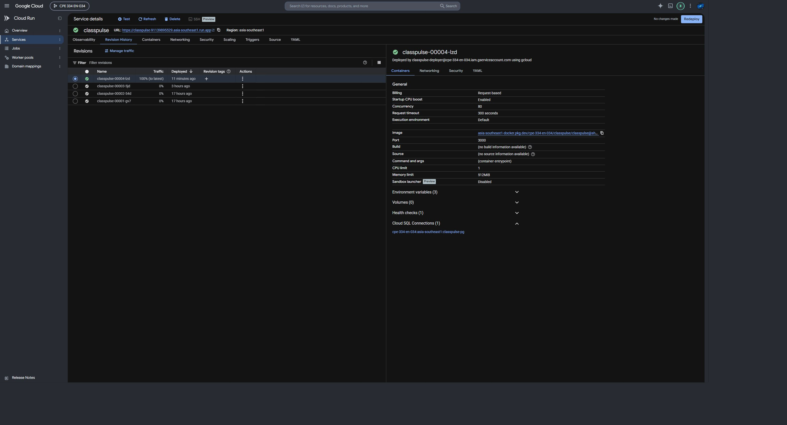

**Figure C-05.9 — survey 2 after reviewed redeployment.** Page: [survey 2](https://classpulse-zdwglar6eq-as.a.run.app/owner/surveys/2); original title, Published state and three questions retained.

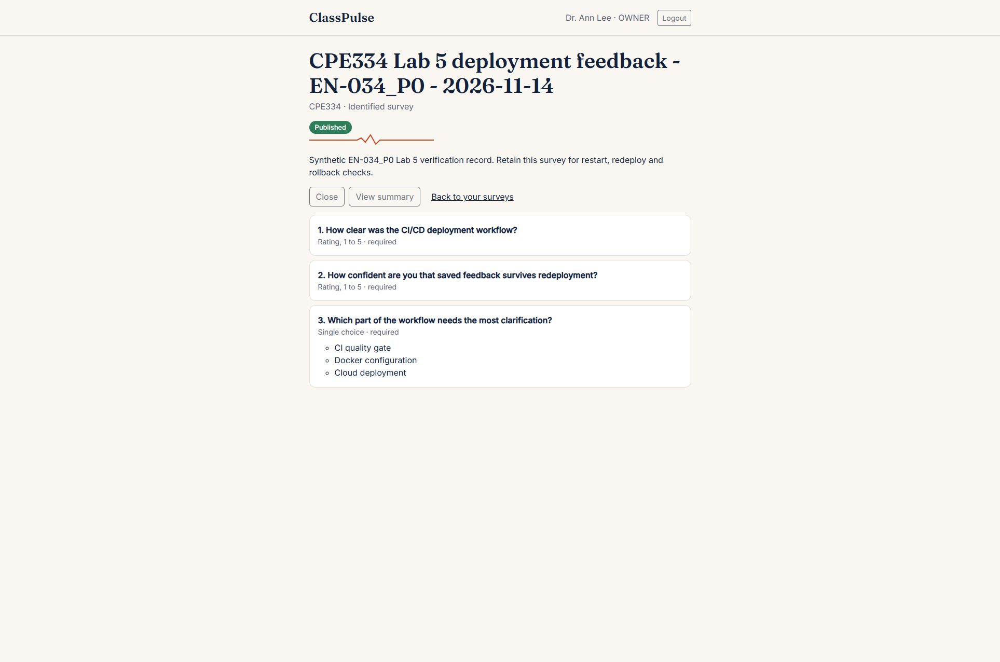

**Figure C-05.10 — direct response 1 after reviewed redeployment.** Page: [saved response](https://classpulse-zdwglar6eq-as.a.run.app/responses/1); original submission timestamp, ratings 4/5 and Cloud deployment retained after a server reload.

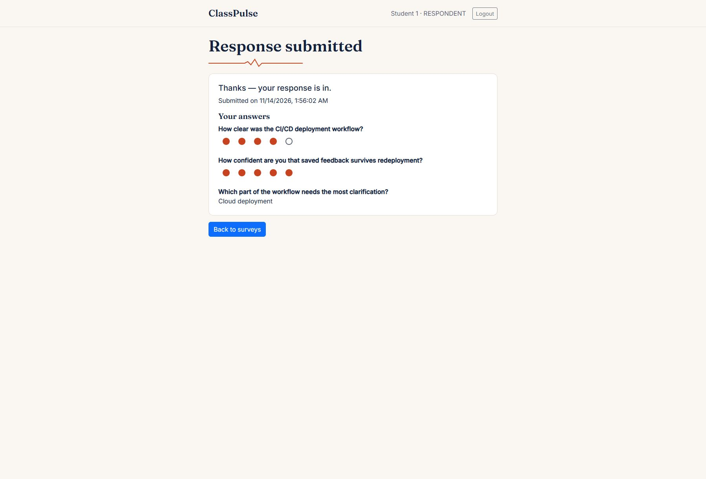

**Figure C-05.11 — owner summary after reviewed redeployment.** Page: [survey 2 summary](https://classpulse-zdwglar6eq-as.a.run.app/owner/surveys/2/summary); count 1, averages 4.00/5.00 and Cloud deployment 1 match the baseline and restart figures.

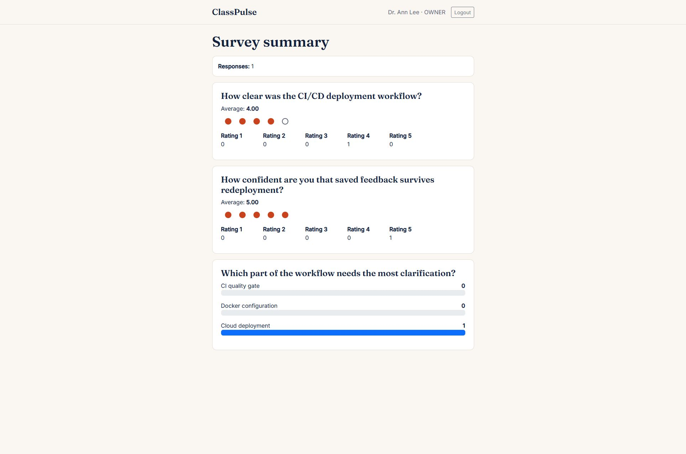

## Remaining checks — no full C-05 claim yet

| Contract criterion | Current result |
|---|---|
| AC1 / T1: baseline and fresh same-image restart | Observed pass: distinct revision, same digest, 100% traffic and matching survey/response/summary. **B reviewed and approved this restart evidence in PR #57 before merging it at f6caa69.** |
| AC2 / T2: reviewed main redeployment | **Observed pass on accepted main 1fe3e3b:** successful run 43585838076, actual revision/digest/100% traffic, unchanged database attachment and matching survey/response/summary. **Awaiting B's evidence review.** |
| AC3 / T3: compatible rollback and roll-forward | **Pending human review/execution.** Two accepted images now exist with identical app/schema/migration/seed/runtime sources. Human must review compatibility, select accepted full SHAs through the reviewed workflow, and have A observe the same record at both steps. The pre-main bootstrap image is not an accepted rollback target. |
| AC4 / T4: teammate evidence review | **Restart-record review complete in PR #57.** B's review of the new redeployment evidence, future rollback/forward evidence and final C-05 acceptance remain pending. |

Restart and separately reviewed redeployment have both been observed with the saved data retained. Issue #32 remains open for the new evidence review, planned human rollback/forward and final acceptance; no full C-05 sign-off is claimed. The final PDF, both-student report review and human LEB2 submission are also outstanding.
