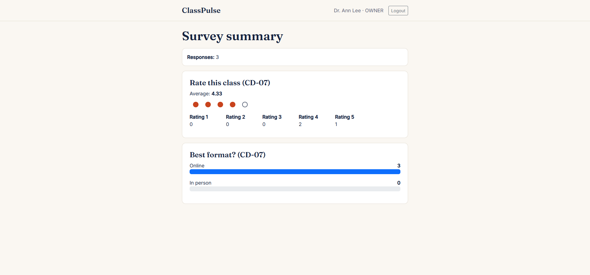

# ClassPulse — Lab 6 report source

## Current status — 25 November 2026, after companion review

**CD-01 inactive login and CD-07 exact aggregate are PASS within the recorded scope**, now supported by C/D's received [JSON](../../../evidence/lab-06/checkpoint-20261124/received-cd-r2-20261125/fixture-case-results.json) and [summary image](../../../evidence/lab-06/checkpoint-20261124/received-cd-r2-20261125/CD07-summary.png), which A reviewed against the preserved report. Inactive user17: before/login/after401 with INVALID_CREDENTIALS at login. Survey26: baseline0; respondents3/5/16 -> responses13/14/15, ratings4/4/5; count3/average4.33, distribution0/0/0/2/1, Online3/In person0; aggregate values agree across API/UI/image without respondent identities. Four active logout204/identity401 observations do not prove controlled expiry/replay. Preserve survey26/responses13–15. [Artifact assessment](../../../evidence/lab-06/checkpoint-20261124/r2-companion-review-20261125/companion-review.json).

**A confirms existing TEST-05 as supporting automated verification only.** C/D may run exact CP-V01 source `1fe3e3b82dfb0537be30223c9b598b3479b4affe` against an isolated local `classpulse_test` target and return actual output. The test backdates fixture expiresAt, then asserts /me401; it does not wait out the live8-hour TTL. Supporting execution/result remains **NOT RUN / NOT RECEIVED** here. **Independent live expiry remains OPEN; final acceptance remains PENDING.** See [method, isolation and return evidence](session-expiry-support.md). No production TTL, code, schema, shared file, deployment or live data change is part of this approval.

C/D run `UAT6-20261125-CodexD-R2` was25Nov17:49:22–17:52:43Bangkok; operator Codex under Thira, model unspecified. Exact reported CP-V01 source is `1fe3e3b82dfb0537be30223c9b598b3479b4affe`, revision `classpulse-00006-6w6`; the earlier narrative supplies digest `sha256:60f61ccccbc559e6c060383ad9acafc6918e1202ec1e7e5e43aa107c35707795`/100% from A's00:36:54mapping. The JSON retains source/revision but states digest/internal wording was removed. No fresh cloud mapping in that run is claimed. Its live origin/asset and unverified-notice/operator limitations remain; no Ashira participation or retrospective start approval is inferred.

Human setup/A READ ONLY postchecks, B's corrected provisioner review/139tests and PR82/84/85 merges are separate completed records; closed Issues79/80 cover their scoped documentation/tool work, not Lab6 completion. WF-BUG-001 is fixed/independently verified/closed for Workflow, not ClassPulsePartD. Remaining coverage, **ClassPulse PartD**, both product decisions and final PDF/submission remain incomplete. No exercise defect is selected. This block stays within new Issue102's Lab6-owned files; Lab7/Sprint2/shared changes require prior coordination. Automations remain paused.

This status supersedes historical missing-companion/report-only statements below. Original received bytes and prior receipt states remain unchanged. No proposed supporting test is presented as executed or as independent live UAT.

## Latest verified state —24November2026, after WF-FIX-001 retest

- Workflow WF-BUG-001 independent corrected-live retest **PASS**:2original boundary tests plus5supplemental checks,0failures/skips,23:03:13–15Bangkok. Full sourcead2cbef67decf9953219694898327dea0bb66034; markers before/afterad2cbef67dec; revision00008-9zd,100%. [Independent result](../../../evidence/lab-06/checkpoint-20261124/a-wf-bug-retest/INDEPENDENT-RETEST.md). C/D cloud mapping is attributed; A checked served source/browser and remote deployment. All A/B business records were left untouched.
- [C/D's latest B-v2 dispositions](../../../evidence/lab-06/checkpoint-20261124/received-cd-corrected/EN037-B-V2-DISPOSITION.md) accept the recorded same-tab/logout02/03 paths, numeric1000000.00 display and scoped06denial; no repeat solely for those capture limits. Earlier original82a4806 snapshots remain historical. B06 still lacks a fresh marker/expanded identity in its screenshot; predeployment C/D readback corroborates release continuity without inventing that capture. The six original Workflow paths have scoped PASS evidence; required unexecuted additional branches and whole-product acceptance remain pending.
- ClassPulse [actual read-only baseline](../../../evidence/lab-06/checkpoint-20261124/fixture-baseline/README.md) completed22:53:02Bangkok:target emails absent, student2id5/student3id4, student3CPE231-only. No accounts created. This is an agent-observed point-in-time snapshot, not human-approved live apply.
- B contract81 merged6dc55d8 after exact-head approval/CI. B implemented PR83; A ran138server tests/build/typecheck at294efc4 but independently reproduced a normalized-email concurrency race and [requested changes](../../../evidence/lab-06/checkpoint-20261124/repository/PR83-REVIEW.md). No live fixture apply until B's regression/fix and new A review, then human target/baseline approval and execution.
- C/D still needs the new inactive/third-respondent fixtures for CD01/CD07, controlled-session coverage disposition and actual peer contribution evidence. ClassPulse PartD is incomplete. The Workflow fix and provisioner review do not substitute. A sends the scoped retest return; B fixes83 and reviews82 at its current head. Final acceptance/PDF/human submission remain pending. Automations remain paused.

Earlier dated paragraphs below retain the sequence of evidence received. Where they say corrected deployment/retest, B setup disposition, live email absence, or provisioner implementation is pending, this latest section supersedes them. Raw incoming/execution files are unchanged.

**DRAFT / NOT FOR SUBMISSION.** Updated on 24 November 2026 under Issue #79. This source records actual observations and pending assessed work. It is not a final PDF, acceptance or submission. Use the [current checkpoint](checkpoint-20261124.md), [coverage review](coverage-review.md), [instructor clarification](instructor-clarification.md) and [exercise protocol](exercise-protocol.md).

The proposed 20–22 November targets are historical. A reports an extension; the official revised deadline remains **PENDING**. Partner availability through 29 November is not the course deadline.

## Cover and navigation

| Field | Actual value / remaining confirmation |
|---|---|
| Student A | Prior report: Bannasorn Thongkorn / 67070503420, GitHub Punge089 verified. Confirm final cover details. |
| Student B | Prior record and B's report: Papangkorn Jitvoottikrai / 67070503421, GitHub book6349. Direct identity and availability confirmation pending. |
| Section / group | Prior Lab 5 used section 31 / EN-034_P0; confirm current course values. |
| Project / repository | ClassPulse: identified course-feedback surveys. https://github.com/Punge089/classpulse |
| Sprint 1 baseline | Protected tag `v1.0.0-sprint1`, peeled commit `d4bad74211729032697164f378638efb834a67b6`, unchanged. |
| ClassPulse tested release | CP-V01, source `1fe3e3b82dfb0537be30223c9b598b3479b4affe`, digest `sha256:60f61ccccbc559e6c060383ad9acafc6918e1202ec1e7e5e43aa107c35707795`, revision `classpulse-00006-6w6`, 100% traffic. https://classpulse-zdwglar6eq-as.a.run.app/ ; A's saved Console readback was 24 November at 02:16:41 Bangkok. This is time-specific evidence, not a new readback now. |
| Partner | Workflow and Approval System, Sprint 1 contract v0.6. https://github.com/osizk/WorkflowAndApprovalSystem ; https://scd928edd-4d7hbszvwq-as.a.run.app/login |
| Partner tested release | Source `82a4806b5291b57ad7e76a28fb7d40e1e947b9a6`, marker `82a4806b5291`, revision `scd928edd-00007-477`, 100% traffic, digest `sha256:6554d7f8cccdf1b4ded95f3f7d1a2560a786b0ecf7613cab62d59d942613a4fb`. C/D supplied the readback at 20:51:51–58 Bangkok on 24 November; A observed the matching marker. |
| Independent partner | C: Ashira Sansoda / 67070503445. D: Thira Rungruangkaset / 67070503419. EN-037_P5. Actual operators and contributions are distinguished below. |
| Final decisions / submission | Both decisions, official revised deadline, filename rules, final file review and human upload receipt remain pending. |

The final PDF requires a contents page, Part A–D page ranges and readable embedded evidence with internal references. Links alone do not satisfy assessed material. The supplied handout has no fixed page limit or required separate video; verify filename rules in LEB2.

| Part | Marks | Current evidence / final PDF pages |
|---|---:|---|
| A — Preparation and handoff | 20 | Handoff, contracts and R11 dispositions; page range pending. |
| B — Independent partner execution | 25 | A's observed cases retained; B and additional execution incomplete. |
| C — Reporting and triage | 20 | Incoming ClassPulse observations and Workflow finding retained. |
| D — Resolution and independent retest | 35 | ClassPulse correction or conditional exercise chain incomplete. |
| Contributions, AI use, limitations and submission | Included | Actual registers retained; final review and upload pending. |

## A — UAT preparation and handoff (20)

Sprint 1 covers authentication and identity; owners creating, publishing and closing their own identified surveys; enrolled respondents listing eligible surveys, submitting once and retrieving saved confirmation; owner aggregate results; and backend role, ownership, enrollment, lifecycle and input rules. Later-sprint editing, new question types, anonymous mode, exports and a response-history list are outside this acceptance. A direct saved-response read is in Sprint 1. Identified surveys must be labelled identified.

Embed the complete reviewed [handoff](handoff.md), [coverage table](coverage.md), applicable [contract/source crosswalk](contract-extracts.md), and independent R11 assessment/additional cases/dispositions. Current ClassPulse technical scope is original UAT-01–12 plus CD-01–08 with residual branches pending. Technical agreement does not establish execution or final participant acknowledgement.

Include stable IDs, expected outcomes, synthetic roles and inputs, sequence, retention, version and actual setup deviations. Never include passwords, connection strings or cookies. C/D reports all five supplied roles accessible. Their actual received run was around 17:31–18:03 Bangkok on 24 November, with CD-08 later at 20:45:30. These are actual times, not retrospectively booked appointments. Future slots/channel discussion was deferred to 25 November; no exact appointment is confirmed.

## B — Independent execution of partner app (25)

A/B reviewed Workflow contract v0.6 independently. C/D's A2 technically accepts original UAT-01–06 and [PARTNER-ADD-01–06 A2](../../../evidence/lab-06/checkpoint-20261124/workflow-additional-cases-a2.md). Retain Unicode boundaries, exploratory stored-trimming treatment, concurrency proof limits, and actual restart versus verified new-instance distinctions. Special setup remains necessary for durability, session, assignment and event-failure checks. Agreement is not a PASS.

| Case | Actual operator / time / version | Actual observation | Disposition |
|---|---|---|---|
| UAT-01 | Codex under A/Punge089, 24 Nov 21:03:40–21:05:38 Bangkok, original `82a4806`. | Created 125.50 request; assigned reviewer approved with blank reason; requester retrieved APPROVED and exactly SUBMITTED → APPROVED. Evidence 02–07. | PASS; setup variation accepted by C/D in A3. |
| UAT-04 | Same operator/version, 21:06:19–21:07:20. | Reused request `e1cc8f10-ccb4-49b1-a391-3d44fd4e3f67`. New login and reviewer reload retained 125.50, status and two original events; Approve/Reject control counts both zero. Evidence 08–10. | PASS for recorded persistence/controls; setup variation accepted. Optional restart NOT RUN. |
| UAT-05 | Same operator/version, 21:07:42–21:09:45. | Separate request `b1f4b385-04b4-4e7a-905f-7f9091e65db2`, 300.00. Blank reason denied; reload retained SUBMITTED/one event. Valid reason saved REJECTED; requester retrieved exact reason and two events. Evidence 11–17. | PASS; setup variation accepted by C/D in A3. UI validation only; no HTTP status inferred. |
| UAT-02 | Codex GPT-6.1 Sol under book6349,24Nov21:27:28–21:34:37 Bangkok,original82a4806 marker. | UI denies invalid amounts and saves0.01/1000000.00 with retained IDs. | PASS for recorded numeric UI path; C/D accepts ungrouped two-decimal display and recorded logout setup. |
| UAT-03 | Same B UI run/release. | Other requester/reviewer cannot list/read B record; requester1 readback unchanged89.00/SUBMITTED/one event. | PASS for scoped UI isolation/unchanged-state path; C/D accepts recorded setup. |
| UAT-06 | B-reported human DevTools run,21:57:46.326 Bangkok. |403/FORBIDDEN, before/after200 retain125.50/SUBMITTED/one event, unchanged:true. Original BLOCKED checkpoint superseded for this probe. | PASS for this scoped denial per C/D; fresh marker/expanded identity absent in capture, with later predeployment release continuity corroboration. |
| Additional cases | A2 technical agreement retained; actual allocation/results pending. | A's additional 01/06 and other unexecuted subcases remain NOT RUN. Special setups remain explicit. | NOT RUN / setup dependent. |

[A's detailed narrative](../../../evidence/lab-06/checkpoint-20261124/a-workflow/RESULTS.md) and [raw observations](../../../evidence/lab-06/checkpoint-20261124/a-workflow/observations.json) retain inputs, expected/actual behavior and per-step UTC times. There are three observed case paths, 15 observations, 26 evidence files and two retained request IDs, not 15 test cases.

The temporary in-app browser did not expose its exact engine/version or a verified private-window flag. Explicit logout, closing a tab, opening a replacement tab and new login verified signed-out denial and new-login persistence, not literal private-window creation. C/D later accepted this setup variation for the three recorded paths in A3; a literal private-window repeat is unnecessary for this scope. The three observed paths are PASS; whole-product acceptance remains pending. Final logout was observed; no existing record, cloud/admin state or process restart was changed. A stale closed-tab helper was rebound before UAT-04 credential entry; this was a tooling issue, not an application defect.

Embed readable [approval](../../../evidence/lab-06/checkpoint-20261124/a-workflow/evidence/06-uat01-approved.jpg), [denial](../../../evidence/lab-06/checkpoint-20261124/a-workflow/evidence/13-uat05-empty-reason-denial.jpg) and [requester readback](../../../evidence/lab-06/checkpoint-20261124/a-workflow/evidence/17-uat05-requester-readback.jpg) figures with action, expected/actual result, time, version and operator captions. Rejected actions need unchanged-state/no-disclosure readback. Keep initial and retest totals separate.

## C — Defect reporting and triage (20)

Workflow discovered and initially test-designed WF-BUG-001. A's Codex independently confirmed it at 19:09:37 Bangkok on 24 November: 102400-byte JSON returned 422; 102401 bytes returned 500 instead of 413. Totals: 2 tests, 1 passed, 1 failed, 0 skipped. [Independent confirmation](../../../evidence/lab-06/checkpoint-20261124/a-wf-bug-confirmation/INDEPENDENT-CONFIRMATION.md) retains output and limits. C/D accepted Minor severity; no outage, data loss or credential disclosure was demonstrated. Expected 413 is the parser's client-error classification, not an explicit status in the original Sprint 1 contract.

C/D's [correction status](../../../evidence/lab-06/checkpoint-20261124/received-cd-a2/Workflow/CORRECTION-STATUS.md) records RED `0e489731` (build succeeded, 1 passed/1 intended failure), GREEN `84a62c7` (2 safety tests and 7 focused checks passed), and full CI `45407729755` (17 passed/0 failed/0 skipped; Docker build passed). A inspected PR #63's diff and verified exact-head remote CI success; A did not rerun the repository suite or supply their teammate's approval. PR #63 was Draft/unmerged at the earlier inspection; C/D A3 later marked it Ready on the unchanged head and requested osizk review. A verified it is open, not Draft and not merged. This paragraph records the earlier inspection. Subsequently release WF-FIX-001 deployed at main merge `ad2cbef67decf9953219694898327dea0bb66034`; A independently retested the original reproduction:2passed/0failed/0skipped plus5supplemental passes. Full evidence and provenance are in the latest-state section. Original82a4806 failure and branch84a62c7 GREEN remain separate historical versions. This finding does not fulfil ClassPulse Part D.

The [received ClassPulse continuation](../../../evidence/lab-06/checkpoint-20261124/received-cd-r1/CONTINUATION-REPORT.md) reports passing behaviors across original UAT-01–12, with API-created setup for 08/10/11. A accepted only that setup deviation after execution. [Received A2](../../../evidence/lab-06/checkpoint-20261124/received-cd-a2/EN037-TECHNICAL-RESPONSE-A2.md) agrees CD-06 anonymous 401/authenticated respondent PUT/DELETE 404 and completes CD-08 authenticated guarded/original missing-ID 404. This is external lookup-before-validation evidence, not database inspection. Prior non-enrolled Draft 403 and enrolled Closed 409 remain separately recorded.

No genuine ClassPulse defect is established in completed observations. CD-01 inactive/controlled-session branches, CD-07 third respondent, actual peer contribution and final acceptance remain pending. This is not a comprehensive no-defect conclusion. The 95 accumulated records are not 95 cases. Received reports retain their original historical statuses; continuation, A2 and checkpoint establish the current read order.

For every actual finding, embed R04/R05 reproduction, expected/actual result, contract basis, evidence, impact-based severity, classification, owner and disposition. Link duplicates and record independent consent to minor limitations. Never invent a count or relabel a failed requirement as an enhancement. Unresolved critical/major findings block acceptance.

## D — Resolution and independent retest (35)

**ClassPulse Part D is NOT COMPLETE.** The [readiness checklist](part-d-readiness.md) names owners, actions and required evidence. Accepted genuine defects follow the normal correction chain. Only after coverage review and thorough independent testing still find no genuine defect does the professor's standardized procedure apply: a new Sprint staging commit reintroduces one previously corrected defect, or disables an existing required-field validation if no suitable earlier defect exists. C/D then independently discovers/reports it without advance exact-defect disclosure.

No exercise defect is selected/inserted and no completed ClassPulse RED/GREEN, correction deployment or independent retest is claimed. Preserve healthy baseline, tests, mandatory CI, protected tag and history. Do not expose defective main or assume defective staging passes CI. Use isolated exposure under the protocol and escalate only an actual policy/environment conflict.

Meaningful RED requires working build/fixtures and the intended failing assertion committed before implementation. GREEN must pass the same assertions, with relevant existing regression, exact commands/counts/output and fix diff. Syntax/setup failures and focused/weakened tests do not substitute. A non-author checks actual head, diff, tests and current CI before a history-preserving merge. A reviewed release goes to main; humans run cloud mutations; C/D independently retests the original reproduction and affected cases on the verified corrected deployment.

Each team issues its own exact-release R07 decision with actual scope, participants, time, results, limits and conditions: Accepted; Accepted with explicit minor limitations; or Not Accepted. Developer GREEN, CI or historical Lab 5 deployment does not replace independent deployed retest. Required BLOCKED/NOT RUN cases or unresolved major/critical findings prevent Accepted. Both final decisions remain pending.

## Version lineage and repository evidence

The [version register](versions.md) and [evidence index](evidence-index.md) retain exact identifiers and provenance. The protected baseline is unchanged. CP-V01 and original Workflow mappings are time-specific. Corrected ClassPulse deployment and both final acceptance decisions remain pending. Corrected Workflow deployment and scoped independent WF-BUG-001 retest are now evidenced above.

Documentation integration is separate from Part D. Historical PR #69/#71 merged in `3d652d8`/`b14cf38`. B approved A #75 at `05134a3` and merged `3425a5e` after CI `45404297275`. A reviewed B #76 at `fa3f181` and merged `b98369c` after 32 offline checks/CI `45396597109`. A reviewed B #78 at `49289a5` and merged `cdcf460` after 16 static checks/CI `45408546110` and B marking that unchanged head Ready. These changes provision no fixtures and deploy no app. Closing planning Issue #74 does not complete Lab 6. A's Issue #79 evidence PR requires B's actual current-head review; A cannot self-approve/merge.

## Contributions, AI use and limitations

Use [actual contributions](contributions.md) and [AI-use declarations](../../ai-use.md). A's Workflow operations were performed by Codex GPT-6 under A, not B. C/D attributes ClassPulse operations to Codex under Thira; Ashira's actual contribution/review still needs evidence. Do not invent personal clicks or retrospective participation from a proposed allocation. Equal commit counts and full prompt transcripts are not required.

Retain the initial PR #76 checker result of 29 passed/2 failed before 32 passed: those failures were checker assumptions about line endings/apostrophes, not product RED/GREEN. Historical missing-model-trailer disclosures for B commit `7fbac15` and merge `3d652d8` remain in contributions; do not rewrite history or guess models. B's later Ready update declares Codex GPT-6.1 Sol; A's current work declares GPT-6.

Remaining dependencies: B identity/availability, remaining additional UAT and setup/version dispositions; C/D residual coverage and actual peer contribution; human fixture setup; ClassPulse Part D; both decisions; official deadline/filename; final PDF review and human upload receipt. Automations remain paused. No future appointment or channel agreement is invented.

## Final assembly and human submission

Before final rendering, embed complete agreed cases/contracts, independent coverage/dispositions, readable observations/figures, findings, RED/GREEN assertions/diff/regression, actual review text/CI/release/deployment/retest, both decisions, contributions, AI use and limitations. Add real contents/page/evidence references. Keep one legible self-contained PDF without secrets.

A assembles; B reviews actual PDF bytes/hash and figures. Changed assessed evidence needs follow-up review. A human checks the real assignment/deadline/filename, uploads to LEB2, opens the uploaded file and retains the receipt. Record filename, hash, page count, reviewer, upload time and confirmation only when real. Until then: DRAFT / NOT FOR SUBMISSION.

## Source history

| Version | Date | Author / assistance | Reason |
|---|---|---|---|
| 0.1 | 20 Nov 2026 | Punge089 / Codex GPT-6.1 Sol | Initial scaffold without execution claims. |
| 0.2 | 20 Nov 2026 | Punge089 / Codex GPT-6.1 Sol | Independent audit and conditional professor exercise. |
| 0.3 | 24 Nov 2026 | Punge089 / Codex GPT-6 | Correct elapsed targets, reported extension and received progress. |
| 0.4 | 24 Nov 2026 | Punge089 / Codex GPT-6 | Issue #79 actual A results, A2/CD-08/mapping, reviewed merges and readiness gates; preserve qualifications. |

See the later A3 section in the [checkpoint](checkpoint-20261124.md) and the unchanged [received disposition](../../../evidence/lab-06/checkpoint-20261124/received-cd-a3/EN037-A3-SETUP-DISPOSITION.md). The initial run metadata remains preserved alongside the later case adjudication; it is not overwritten.

| 0.5 | 24 Nov 2026 | Punge089 / Codex GPT-6 | Record received A3 setup acceptance, three scoped PASS results, Workflow review-ready status and A C3 for B contract81; no new live execution or whole-product acceptance. |

See the latest B v2 section in the [checkpoint](checkpoint-20261124.md). [B's retained report](../../../evidence/lab-06/checkpoint-20261124/b-workflow/RESULTS.txt) and [human06 addendum](../../../evidence/lab-06/checkpoint-20261124/b-workflow/UAT06-human-result.txt) supply actual evidence;48 observations are not48 cases. UAT06 execution is21:57:46, not its21:34:21 creation timestamp. Same-tab setup, comma display and missing fresh marker/expanded identity remain explicit. Supplemental UI checks do not establish backend statuses or complete additional cases. No final acceptance is claimed.

Workflow release64 now has actual osizk approval and current-head CI success on eee7c7e; corrected deployment and independent live retest still await actual evidence. Initial release-event deploy/test jobs were skipped on the PR event, not executed deployment. A's clearance reply is prepared for the student to forward and has not been sent by Codex. No additional live Workflow run is performed during consolidation.

| 0.6 | 24 Nov 2026 | Punge089 / Codex GPT-6 | Retain B v2's qualified original/UI/additional observations and later human06, correct stale NOT RUN/C3 states, record actual release64 review/CI and unsent deployment coordination. |

| 0.7 | 24 Nov 2026 | Punge089 / Codex GPT-6 | Record C/D B dispositions, WF-FIX-001 deployment and actual independent retest, read-only fixture baseline, contract81 merge and PR83 concurrency review blocker; preserve original failures and unfinished ClassPulse PartD. |

| 0.8 | 25 Nov 2026 | Punge089 / Codex GPT-6 | Record actual human fixtures, READ ONLY postchecks/current release, private handoff provenance, corrected provisioner review and Workflow closure; keep independent coverage and ClassPulse PartD incomplete. |

| 0.9 | 25 Nov 2026 | Punge089 / Codex GPT-6 | Receive C/D R2 scoped PASS report for inactive login and survey26 summary; retain missing raw evidence, supplied version basis, communication/operator limitations and incomplete expiry/acceptance/PartD. |

## Received R2 summary figure and supporting-method decision

A reviewed the actual received JSON and supplied image; the two scoped result paths are now evidence-supported PASS. This review is not a new A live execution. The image's owner header is permitted identity context; the aggregate content exposes no respondent identities. C/D records the run on CP-V01 source1fe3e3b/revisionclasspulse-00006-6w6 with the stated earlier mapping limitation.

Figure: C/D-supplied owner summary, matching JSON UI observation25Nov17:52:32.958Bangkok. Screenshot pixels do not independently prove the timestamp/revision; those come from the received run metadata. The original clipboard attachment is retained byte-for-byte under the narrative's expected filename, with its received-source hash/name recorded.

Existing TEST05 may supply local automated support at exact CP-V01; no actual supporting output is received yet. Independent live expiry and final acceptance remain open. See [expiry method](session-expiry-support.md).

| 1.0 | 25 Nov 2026 | Punge089 / Codex GPT-6 | Verify actual R2 JSON/image and resolve missing links; record two scoped PASS paths and accept existing TEST05 only as a pending local supporting method, with independent live expiry/acceptance unchanged. |
