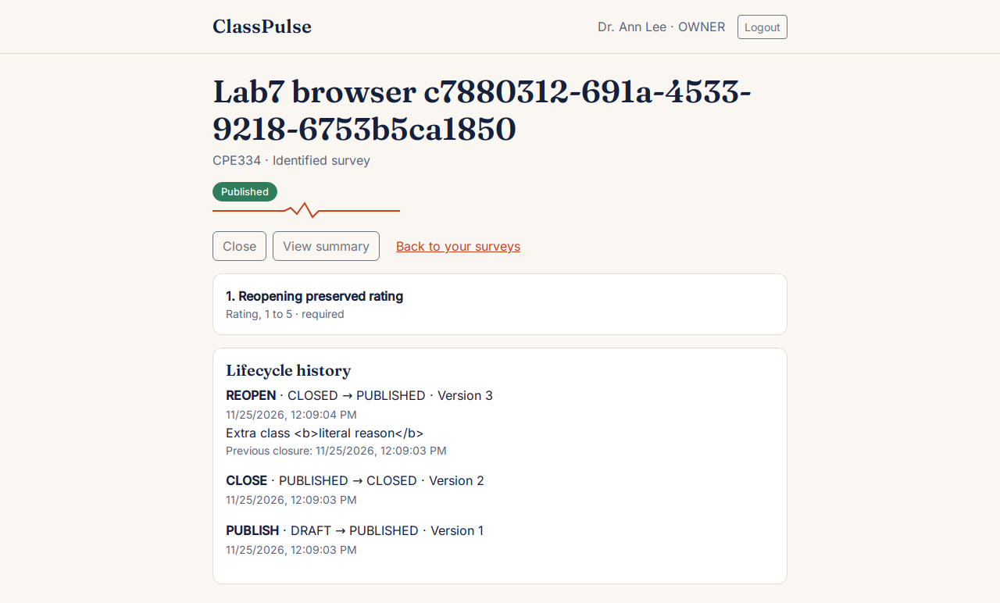
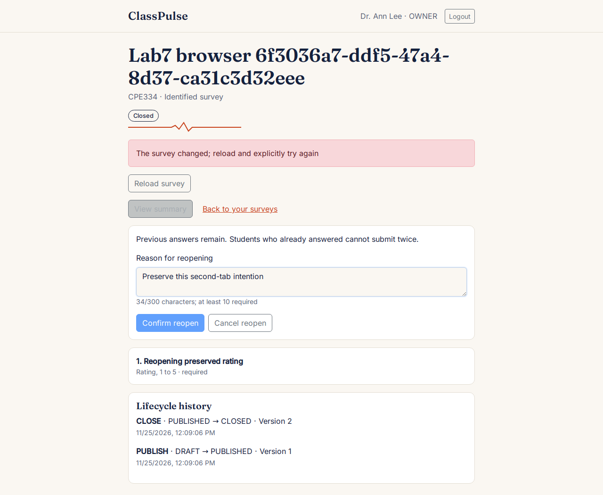
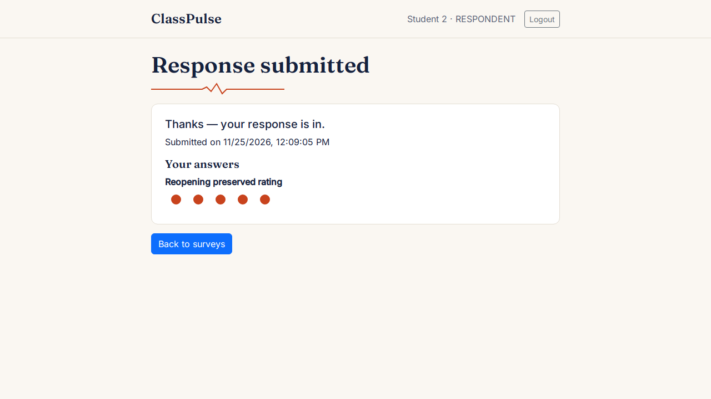

# ClassPulse - Lab 7 maintenance report

**Version 0.7 - WORKING DRAFT - NOT READY FOR SUBMISSION**

Historical test and metrics snapshot: 2026-11-25T19:50:53.113529+07:00. Baseline and PR #92 readback: 2026-11-27T18:20:33+07:00. Lab 7 merged into main and automated deployment passed. Cloud Run and a pre-existing response were verified. The live API check passed. B’s final metrics and PDF review are pending. This PDF covers Lab 7.

| Student | ID | GitHub | Actual role at this snapshot |
|---|---|---|---|
| Bannasorn Thongkorn | 67070503420 | Punge089 | Contract/test/implementation/report driver; reviewed and merged B's interim metrics PR #100 |
| Papangkorn Jitvoottikrai | 67070503421 | book6349 | Reviewed the contract before tests; authored metrics/readiness/retrospective; approved and merged #92; final PDF review pending |

Theme 10: university course feedback. Repository: https://github.com/Punge089/classpulse. Due 29 November 2026, 23:59 Asia/Bangkok. Final PDF submission is pending.

## Navigation and version map

| Part | Points | Sections / evidence IDs | Final PDF pages |
|---|---:|---|---|
| A - change and reviewed contract | 25 | A1-A4; L7-A01..A04 | Draft page range calculated at render |
| B - implementation and regression-safe delivery | 50 | B1-B6; L7-B01..B12 | Draft page range calculated at render |
| C - objective metrics | 15 | C1-C3; L7-C01..C03 | Draft page range calculated at render |
| D - readiness and retrospective | 10 | D1-D4; L7-D01..D03 | Draft page range calculated at render |

| Reference | Exact value / status | Meaning |
|---|---|---|
| Original submitted Sprint 1 tag | v1.0.0-sprint1, d4bad74211729032697164f378638efb834a67b6 | Immutable historical release; not substituted for Lab 6 acceptance |
| Lab 6 CP-V01 source | 1fe3e3b82dfb0537be30223c9b598b3479b4affe | Attributed from Lab 6 records; not freshly cloud-verified by this report |
| Accepted Sprint 1 release from Lab 6 | CP-FIX-001 / bee0d122bf23410e3d2db69649ad5e44959b6cd8; Cloud Run classpulse-00007-6t9 | D accepted identified scope 27 Nov 01:35:39 ICT; C acknowledged 02:01:21 |
| Actual pre-change implementation | 8017c9183302e4e0c5ff04cd997704255420b8fb | Contract-only commit on staging c99748c; old server/client behavior unchanged |
| Primary test head | 3f8918ceefd5eb55cdebd970710fd0789bd38c98 | Existing app plus two new missing-behavior assertions |
| Primary CI tested merge | d34d22018affa62c75009fa4e8be01b7ab728799 | Test merge of c99748c and3f8918c, not a different implementation |
| Historical feature test snapshot | 45f48cdcd0999e2dbbb5cb4e70638999ff25e3e8 | Run 45613368930; retained step logs and figures below |
| B-approved PR #92 head | 698b1e965ba2c429e9296cac4159368b864ae4bd | B C7 26 Nov 2026 00:06:19 ICT; required CI run 45645429150 |
| Feature staging integration | e6043a9843eaeebaa63464aa19e5e8d1e503996a | B merged 26 Nov 2026 10:43:38 ICT; same parents and tree as required CI checkout |
| GitHub staging at readback | 5fe00fd3e065cc6fb0cb1edd0aaf80ae5bfbd347 | Descendant of the Lab 7 feature merge |
| GitHub main before Lab 7 release | bee0d122bf23410e3d2db69649ad5e44959b6cd8 | Prior Lab 6 release from PR #121 |
| Reviewed Lab 7 main merge | 8316f270cb11d47c75f848de3f3d40acefbe8def | PR #143; automated deploy run 46050688714 passed. No release tag is claimed |
| Lab 7 service URL | https://classpulse-zdwglar6eq-as.a.run.app | classpulse-00008-qlw received 100% of traffic at readback. See B6 for image digests. |

Intervening work includes Lab 5 deployment/CI and Lab 6 test tooling and UAT evidence. The Lab 6 title-validation correction reached main in PR #121. Sprint 2 staging has since absorbed later-sprint work, including F-09 response history (PR #119). The two old lifecycle implementation files match across the accepted release and the RED source. See A1 for the source comparison.

# Part A - Change impact and updated contract (25)

## A1 - Precise change and announcement (L7-A01)

Issue #87 changes previously correct terminal-CLOSED behavior. Proposed scenario: interrupted class collection needs to resume without cloning the survey, losing answers or letting previous respondents submit twice. Owner-only explicit reopening requires a trimmed 10-300 UTF-16-unit reason and current lifecycle version, writes one durable event atomically, preserves first publication/previous answers and never returns to DRAFT.

The supplied later announcement states: "You need not get Instructor or TA Approval for your change request to Sprint 1." The team must choose a nontrivial change. This supersedes the individual approval requirement in the original PDF; it does not remove teammate contract review. The announcement's original publisher/publication date were not independently supplied/verified; A supplied its text on25 Nov. The supplied highlighted image shows the older paragraph, not a screenshot of the later announcement. Source PDF SHA256:13a82d2ec507a84aecd56811bf21f532439e5bb89c34002863d28098cf8b24cb.

Old SRS row, actual pre-change rule:

| ID | Assessed requirement | Sprint |
|---|---|---|
| BR-03 | Status changes only `DRAFT → PUBLISHED` (publish) and `PUBLISHED → CLOSED` (close). Any other request is rejected and the status is unchanged. | 1 |

D records **Accepted** for CP-FIX-001, Sprint 1 identified surveys, on 27 November at 01:35:39 ICT. C later acknowledged D's decision and confirmed D's isolated evidence on 27 November at 02:01:21 ICT. The earlier 26 November 19:05:26 decision was Not Accepted. The current decision record and C's acknowledgment are pinned in L7-A01. Historical live M01 remains **BLOCKED**: identity returned HTTP 200 before logout and logout returned 204, while the former-session result was unobserved. The isolated exact-source auth suite passed 8/8, including TEST-04, with 0 failures or skips. Its serving revision is N/A. An earlier isolated invocation stopped all 8 tests at fixture setup because the seed setting was absent. See Part D for the verified defect retest.

The first reopening implementation was committed on 25 November at 18:05:22 ICT; B merged the feature on 26 November at 10:43:38 ICT. D's baseline acceptance followed both events. The two old-code files below have identical Git blob hashes on CP-FIX-001, contract-only 8017c91 and primary RED test head 3f8918c.

| Old implementation path | Shared Git blob |
|---|---|
| server/src/routes/ownerSurveys.ts | a2a00a493397ddcdc8a5947bf5a435ab8d88d47d |
| server/src/lib/surveyLifecycle.ts | d315a489e0a3c6a2e044c5d0ab5c812cae343ef7 |

The old owner router exposed publish and close. The shared lifecycle body implements BR-03:

```ts
import type { SurveyStatus } from "@prisma/client";
import { ApiError } from "./errors";

export type SurveyAction = "publish" | "close";

/** BR-03: DRAFT → PUBLISHED on publish, PUBLISHED → CLOSED on close; everything else is 409 INVALID_TRANSITION. */
export function nextStatus(current: SurveyStatus, action: SurveyAction): SurveyStatus {
  if (action === "publish" && current === "DRAFT") return "PUBLISHED";
  if (action === "close" && current === "PUBLISHED") return "CLOSED";
  const verb = action === "publish" ? "published" : "closed";
  throw new ApiError(409, "INVALID_TRANSITION", `A ${current.toLowerCase()} survey cannot be ${verb}`);
}
```

Revised relevant rows committed before tests in8017c91:

| ID | Assessed requirement | Sprint |
|---|---|---|
| FR-19 | An owner reopens an own closed survey with a reason and current lifecycle version and reads durable lifecycle history; historical responses are preserved. Proposed #87, not implemented. | Lab 7 / D2 |
| BR-03 | Original Sprint 1: DRAFT -> PUBLISHED (publish), PUBLISHED -> CLOSED (close). Lab 7 proposal #87 additionally permits CLOSED -> PUBLISHED through explicit owner reopen with reason/current lifecycle version; publish on CLOSED still rejects. See BR-15. | 1 + Lab 7 proposed |
| BR-15 | Explicit reopen requires a trimmed 10-300 UTF-16-unit reason and matching lifecycle version. Every new publish/close/reopen transition atomically increments that version and appends an immutable event; failure leaves state/history unchanged. No fake historical backfill. Proposed #87. | Lab 7 / D2 |

## A2 - Relevant SRS/feature/system SDS revision (L7-A02)

The following is the actual changed-specification diff c99748c to8017c91. It includes only revised assessed sections, not the unchanged SRS. Its prospective/C3-pending wording is historical: the review below occurred later, before tests/code.

```diff
diff --git a/docs/features.md b/docs/features.md
index 4540292..759b1eb 100644
--- a/docs/features.md
+++ b/docs/features.md
@@ -45,3 +45,8 @@ the number is left empty so existing IDs never change.
   without F-03, because tests create surveys directly in the database; only the full UI journey needs F-03.
 - F-07 touches authoring, answering and the summary, so it follows F-03, F-04 and F-05.
 - F-11 (anonymous) needs F-07 types and the Sprint 3 privacy design; F-12 needs F-11.
+
+
+## Lab 7 F-03 maintenance extension (proposed v1.1, 25 November 2026)
+
+Issue #87 adds FR-19/BR-15 and revises BR-03 within existing F-03, preserving its stable ID and original Sprint 1 scope/history. Controlled reopening changes the formerly terminal CLOSED state through a separate owner-only operation with reason, optimistic lifecycle version and atomic audit; original publish-on-CLOSED rejection stays. This is not F-06 draft editing or a replacement for F-06..F-10. [Complete contract/impact/AC/STS](labs/lab-07/maintenance-contract.md). State: contract proposed, B C3 pending, no tests/code/release. Version 1.1 reason: record changed collection need before implementation; prior v1.0 inventory remains the historical baseline.
diff --git a/docs/sprints/sprint-1/F-03-survey-authoring.md b/docs/sprints/sprint-1/F-03-survey-authoring.md
index d365cac..86a1b4c 100644
--- a/docs/sprints/sprint-1/F-03-survey-authoring.md
+++ b/docs/sprints/sprint-1/F-03-survey-authoring.md
@@ -169,3 +169,14 @@ All six owner routes are also appended to `PROTECTED_ROUTES` in `server/tests/ap
 | v1.0 | 2026-11-06 | Punge089 | Initial contract, written before tests and code. |
 | v1.1 | 2026-11-06 | Punge089 | After C3 review by book6349: (1) the check order for create now follows plan §2.5 (course ownership 404 before field validation 400; a malformed `courseId` is 400), with a test case for a foreign course plus an invalid title; (2) TEST-11 lists its 18 cases explicitly, including the duplicate pair `"Yes"` and `" yes "`. |
 | v1.2 | 2026-11-07 | Punge089 | After the review of PR #18: two tests carried the ID TEST-20 (the survey list and the course list). The survey list keeps TEST-20; the course-list check becomes TEST-58, and AC-18 now names the course list so the test has a criterion. The two E2E scenarios of TEST-21 are named TEST-21a and TEST-21b. No behaviour change. |
+
+
+## Lab 7 maintenance addendum - proposed v2.0, Issue #87
+
+The v1.0-v1.2 sections above describe the original Sprint 1 contract and remain preserved. For the proposed Lab 7 version, §§2/3/5/6/7/8/9/10 are extended by the [complete maintenance contract](../../labs/lab-07/maintenance-contract.md), committed before tests/code. B C3 pending.
+
+Old: CLOSED is terminal. New: only the owner can explicitly POST reopen with a trimmed10..300 UTF-16-unit reason/current lifecycle version; CLOSED->PUBLISHED preserves original publishedAt/answers, records the previous closedAt, clears current closedAt, increments statusVersion and atomically appends an event. Existing publish-on-CLOSED remains409, so AC-14 and original TEST-15/16 remain valid. No draft edit, question mutation or repeated respondent submission is enabled.
+
+Additional endpoints: POST /api/owner/surveys/:id/reopen and GET /api/owner/surveys/:id/lifecycle; both use401/403/404 auth/role/ownership rules. Detail DTO adds statusVersion. New400 invalid reason/version/query and409 stale/invalid-state rules are explicit in maintenance §§4/6. UI shows CLOSED reason confirmation and durable paginated history. Additive statusVersion/event migration replaces the original no-schema-change statement only for this maintenance extension; no old rows or events are invented/deleted.
+
+New acceptance AC-100..111 and test designs TEST-100..114 cover boundaries, concurrency/ABA, audit rollback, history privacy, unchanged responses/summary, migration, UI and deployment. Complete inputs/preconditions/expected results/files are embedded in maintenance §10. The original six transition tests remain; new reopen cases are additive. Version2.0 proposed,25Nov2026,A: changed collection requirement, awaiting team review; no implementation is claimed.
diff --git a/docs/srs.md b/docs/srs.md
index 49082b4..4a3c301 100644
--- a/docs/srs.md
+++ b/docs/srs.md
@@ -61,6 +61,7 @@ payment or any external API, real student data.
 | FR-16 | An owner creates an anonymous survey; respondents are told before answering. | 3 |
 | FR-17 | An owner exports responses as CSV (identified: with respondent; anonymous: without). | 3 |
 | FR-18 | An owner filters the summary by section and reads text answers. | 3 |
+| FR-19 | An owner reopens an own closed survey with a reason and current lifecycle version and reads durable lifecycle history; historical responses are preserved. Proposed #87, not implemented. | Lab 7 / D2 |

 **Observable behaviour of Sprint 1 requirements**

@@ -80,7 +81,7 @@ payment or any external API, real student data.
 |---|---|---|
 | BR-01 | Only `DRAFT` surveys may have questions added, changed or removed. | 2 |
 | BR-02 | A survey has 1–20 questions; prompt 1–300 chars; a `SINGLE_CHOICE` question has 2–6 distinct, non-empty options (≤ 100 chars); a `RATING` question has no options. Title 1–120 chars, description ≤ 1000. | 1 |
-| BR-03 | Status changes only `DRAFT → PUBLISHED` (publish) and `PUBLISHED → CLOSED` (close). Any other request is rejected and the status is unchanged. | 1 |
+| BR-03 | Original Sprint 1: DRAFT -> PUBLISHED (publish), PUBLISHED -> CLOSED (close). Lab 7 proposal #87 additionally permits CLOSED -> PUBLISHED through explicit owner reopen with reason/current lifecycle version; publish on CLOSED still rejects. See BR-15. | 1 + Lab 7 proposed |
 | BR-04 | Responses are accepted only while the survey is `PUBLISHED`. | 1 |
 | BR-05 | Only respondents enrolled in the survey's course may respond. | 1 |
 | BR-06 | At most one response per respondent per survey, including simultaneous attempts. | 1 |
@@ -92,6 +93,7 @@ payment or any external API, real student data.
 | BR-12 | `TEXT` answers ≤ 500 chars; `MULTI_CHOICE` answers pick 1…n distinct options of that question. | 2 |
 | BR-13 | Anonymous mode: no stored link between a respondent and their answers; participation is recorded separately; mode cannot change after publish. | 3 |
 | BR-14 | Aggregate results of an anonymous survey are hidden until it has ≥ 5 responses. | 3 |
+| BR-15 | Explicit reopen requires a trimmed 10-300 UTF-16-unit reason and matching lifecycle version. Every new publish/close/reopen transition atomically increments that version and appends an immutable event; failure leaves state/history unchanged. No fake historical backfill. Proposed #87. | Lab 7 / D2 |

 Clarification of BR-07: a question marked `required: false` may be left unanswered; no `Answer` row is stored for it.

@@ -131,7 +133,7 @@ Clarification of BR-07: a question marked `required: false` may be left unanswer
 | D-05 | Wrong role → 403; a record the caller does not own → 404. | A 404 does not reveal that another owner's survey or another student's response exists. |
 | D-06 | Opaque session token in an httpOnly cookie, hash stored in a `Session` table. | Logout can invalidate immediately (NFR-04); no token in client code. |
 | D-07 | Ratings are integers 1–5. | Simple, comparable averages and distributions. |
-| D-08 | Status flow is only DRAFT → PUBLISHED → CLOSED. | Deterministic lifecycle; reopening is not needed for the stakeholder problem. |
+| D-08 | Original Sprint 1 made CLOSED terminal. Lab 7 proposal #87 allows explicit controlled reopen, never a return to DRAFT. | Changed need: extend collection after a class interruption without cloning or losing answers; retain reasons and audit. B team review pending. |

 ## 10. Open questions and their resolution

@@ -148,3 +150,4 @@ Clarification of BR-07: a question marked `required: false` may be left unanswer
 |---|---|---|
 | 1.0 | 6 Nov 2026 | Initial SRS. |
 | 1.1 | 6 Nov 2026 | After the review of PR #12 by book6349: D-04 no longer attributes both BR-06 and BR-09 to one database constraint (BR-06 is the unique constraint, BR-09 is the API exposing no write route); NFR-01's verification now includes TEST-57, which checks that no plaintext password or session token reaches the server's logs. |
+| 1.2 proposed | 25 Nov 2026 | Issue #87, A: revise BR-03/D-08 and add FR-19/BR-15 before tests/code for controlled reopening. B agreement/C3 pending; old terminal behavior retained in tag/history. Detailed AC-100..111/TEST-100..114 in [Lab 7 contract](labs/lab-07/maintenance-contract.md). |
diff --git a/docs/system-sds.md b/docs/system-sds.md
index ad684fa..15db0f8 100644
--- a/docs/system-sds.md
+++ b/docs/system-sds.md
@@ -195,3 +195,17 @@ The approved `main` release, cloud resources and all live C-02/C-04/C-05/C-06 ev
 |---|---|---|
 | 1.2 | Added a Lab 5 as-built deployment architecture, CI/release flow, evidence status and human-gate boundaries while retaining the Sprint 1 baseline. | Issue #33; reflects merged staging head `9dae599`; no live deployment is claimed. |
 | 1.1 | Clarified response endpoint check order, inactive-session handling, and production cookie security; split the role matrix by operation and named the PulseLine loading state. | Addressed the review on PR #16 and aligned the SDS with plan §§2.5/2.9 and F-01 §3. |
+
+
+## Lab 7 proposed system revision v1.3 - Issue #87
+
+Prepared by A within #87 Files; B remains system-document owner/reviewer. This section revises the current proposed lifecycle design before implementation, while §§1-8 retain historical Sprint 1/Lab 5 context. B C3 pending; not as-built. [Normative feature contract](labs/lab-07/maintenance-contract.md).
+
+- Data (§2): additive Survey.statusVersion default0 and SurveyLifecycleEvent (id, surveyId, actorId, action, from/to status, version, occurredAt, reason, previousClosedAt), unique survey/version and survey/id index. Restrictive audit FKs; no event update/delete API. Existing records/timestamps/answers retained, no invented historic events. Test cleanup deletes audit rows first only in isolated guarded test DB.
+- Transactions (§2): publish, close and new reopen conditionally update owned status/version and insert event in one transaction; failure rolls back both. Reopen preserves first publishedAt and captures previous closedAt before clearing it. Legacy CLOSED without publishedAt rejects without repair. Concurrent/stale requests409; no automatic retry.
+- UI (§3): owner CLOSED detail gets reason + explicit confirm/cancel, conflict/reload guidance and paginated read-only history. Preserve entered reason on error, identified labeling and original questions/summary.
+- API (§4): POST /api/owner/surveys/:id/reopen accepts exactly reason and expectedVersion, returns owner survey DTO plus statusVersion; GET /api/owner/surveys/:id/lifecycle accepts limit1..100(default20)/before cursor, returns scoped events and nextCursor. Owner create/detail/mutation DTO gains statusVersion. Exact fields, order and invalid cases are in contract §§4-6.
+- Permissions (§5): both new routes401 without session,403 for RESPONDENT,404 for foreign/missing/malformed id; ownership before body/query validation. Audit response excludes actor emails, credentials, respondents and answers. Original publish/close rules remain on their own endpoints.
+- Deployment (§7): additive reviewed migration, preserve historical data, no live seed/reset. Old-code rollback after new audit writes needs frozen lifecycle mutations and explicit review, because old code cannot maintain event completeness. Lab 6 active deployment remains coordinated separately.
+
+Version v1.3 proposed,25 Nov2026,A: introduce controlled reopen/audit impact before tests/code; B approval and actual implementation are pending.
diff --git a/docs/traceability.md b/docs/traceability.md
index 6ec174a..da431ec 100644
--- a/docs/traceability.md
+++ b/docs/traceability.md
@@ -84,3 +84,16 @@ The 42 baseline requirement rows above retain the assessed Sprint 1 results and
 | 1.3 | 7 Nov 2026 | I-10: the result columns of the 23 Sprint 1 rows that have automated tests are filled (NFR-05 and NFR-09 say "manual" and point to their evidence) from `python tools/test_results.py` on commit `4eb2dce` (server 101, client 1, e2e 8 passed, 0 failed, 0 skipped, exit 0). TEST-40 (journey, `docs/sprints/sprint-1/I-10-journey.md`) is added to FR-07, FR-08 and NFR-07 next to the tests that already covered them. |
 | 1.4 | 8 Nov 2026 | I-11: the Sprint 1 results were produced again in a clean clone at the release tag `v1.0.0-sprint1` (commit `d4bad74`): server 101, client 1, e2e 8 passed, 0 failed, 0 skipped, generator exit 0, 39 of 39 acceptance criteria pass. The table is identical to the run on `4eb2dce` apart from the commit and the time, so the result cells now say `@ d4bad74`. |
 | 1.5 | 15 Nov 2026 | Issue33: add the verified Lab5 NFR-05 persistence extension with exact accepted evidence/review links and manual-readback limits. Preserve all42 baseline rows, Sprint1 result counts and protected tag; extension review requested from B. |
+
+
+## Lab 7 proposed traceability revision v1.6 - Issue #87
+
+The42 original baseline rows/results above are historical; none is relabeled as proof of new code. Proposed new/current behavior is NOT IMPLEMENTED, NOT RUN, NOT ACCEPTED. B C3 pending. [Contract and complete STS](labs/lab-07/maintenance-contract.md).
+
+| Requirement | Feature / delivery | AC | Planned test / file | Actual result/version |
+|---|---|---|---|---|
+| FR-19 (new) | F-03 / Lab 7 and D2 | AC-100..111 | TEST-100..114; server/tests/api/surveyReopen.test.ts, unit/surveyLifecycle.test.ts, unit/surveyReopenValidation.test.ts, client/tests/surveyReopen.test.tsx, e2e/survey-reopen.spec.ts | NOT RUN; contract proposed |
+| BR-03 revised | F-03 / Lab 7 | AC-100/101/103/104 | TEST-100/103/104/105/106/114; retain TEST-15/16 old publish/close expectations | NOT RUN; old Sprint1 PASS does not cover reopen |
+| BR-15 (new) | F-03 / Lab 7 | AC-102/103/104/106/107/109 | TEST-101/102/105/106/108/109/111 | NOT RUN; contract proposed |
+
+Preserved cross-cutting NFR-02/03 are explicitly tested by AC-105/TEST-107; persistence NFR-05 by AC-109/111 and TEST-111/113; original BR-04..10 by AC-108/TEST-110 and full regression. These are planned mappings, not new baseline requirements or passing results. Version1.6 proposed,25Nov2026,A: add changed requirement mappings and disclose unimplemented/unexecuted status before tests/code.
```

## A3 - Reviewed engineering contract and impact map (L7-A03)

The following complete relevant state/UI/API/data/impact/AC/STS excerpts are from the pre-code contract 8017c91. They are design/expected outcomes; actual execution is reported separately in Part B. The original contract's local-copy migration plan was executed on a guarded disposable CI schema, as disclosed in B4. There is no monetary/rounding rule change (not applicable); existing summary precision remains protected by regression.

### 3. State and transaction behavior

| Current status | publish | close | reopen |
|---|---|---|---|
| DRAFT | PUBLISHED | 409 INVALID_TRANSITION | 409 INVALID_TRANSITION |
| PUBLISHED | 409 INVALID_TRANSITION | CLOSED | 409 INVALID_TRANSITION |
| CLOSED | 409 INVALID_TRANSITION | 409 INVALID_TRANSITION | PUBLISHED, valid reason + current version required |

All three transitions run in one database transaction. Read the caller-owned row, validate the action, then conditional-update by id/owner/status/**statusVersion**. Increment statusVersion by exactly one. Insert exactly one event with the resulting version and fetch the response DTO within that transaction. Zero changed rows gives 409 `STALE_SURVEY`; audit insert failure rolls back the update. No automatic retries that could turn a stale user intent into a later action. Concurrent reopen calls on the same version yield one 200 and one 409; there is one corresponding event.

For existing publish/close requests, keep the bodyless request contract. The version read inside their transaction guards the update; callers do not have to send a version. Existing invalid action/status combinations retain `INVALID_TRANSITION`. For reopen, compare the explicit expectedVersion before status validation: stale version yields `STALE_SURVEY`; a matching version with wrong status yields `INVALID_TRANSITION`.

Reopen preserves the first `publishedAt`, sets current `closedAt` to null, and preserves the preceding close timestamp in the reopen event's `previousClosedAt`. A later close sets a new `closedAt`. No rows are cloned/deleted; original survey, question, option, response and answer IDs/values remain. Repeated close/reopen cycles append events; nothing overwrites prior events. Existing CLOSED rows with a null closedAt are allowed (historical null retained), with no invented closure timestamp. Reopening requires a non-null original publishedAt; inconsistent legacy CLOSED rows without it fail 409 `INVALID_TRANSITION`, with no automatic data repair.

F-04 still accepts a response only when open and eligible; one response per respondent/survey remains enforced by the existing unique constraint. Previously answered students cannot answer again after reopening. Students who had not answered may submit on the reopened survey. Closed surveys remain rejected and absent from the open list. Summaries/history remain unchanged by reopening alone.

### 4. Permissions and error order

| Operation | Unauthenticated | RESPONDENT | OWNER |
|---|---|---|---|
| POST reopen | 401 UNAUTHENTICATED | 403 FORBIDDEN | own survey only; missing/foreign/malformed id 404 NOT_FOUND |
| GET lifecycle history | 401 UNAUTHENTICATED | 403 FORBIDDEN | own survey only; missing/foreign/malformed id 404 NOT_FOUND |

Existing auth/role middleware executes first. After ownership, validate request body/query (400), then reopen version (409), then status/legacy invariant (409), then conditional transaction (409 on race). Invalid body/query on someone else's valid survey ID must still produce 404. Do not return another owner's survey, reasons, lifecycle version or event count. Invalid JSON is rejected by the existing global JSON parser before route-specific checks; do not change that global behavior in this issue. Unexpected storage failures use the existing sanitized 500 error path, with no stack/connection/secret in the response.

### 5. UI behavior

The existing owner detail page shows Reopen only for CLOSED. Reveal a labeled reason textarea, validation message and explicit Confirm reopen/Cancel controls. Explain that previous answers remain and students cannot submit twice. Use trimmed length 10-300 UTF-16 code units (same JavaScript length semantics on client and server); show a count/limit. Send the latest loaded statusVersion. Disable mutation controls while pending; preserve entered reason on network/validation failure. On successful response update status and version, clear the form and refresh lifecycle history.

On `STALE_SURVEY`, keep the reason, explain that the survey changed and require reload/explicit retry using new details; never retry automatically. CLOSED-to-publish remains unavailable. The page shows loading/empty/error/history states, reason as escaped text, action/from/to/time/version, and Load older for pagination. Historic rows with no recorded events display "No lifecycle events recorded for this version"; do not imply they were never published/closed. Event history and form must be keyboard accessible. Existing identified notice, summary link and question display remain.

### 6. API contract

All errors retain `{ "error": { "code", "message", "details"? } }`.

`POST /api/owner/surveys/:id/reopen`

- Body exactly `{ "reason": string, "expectedVersion": integer }`; reject arrays/null/unknown keys, absent/non-string reason, absent/non-integer/negative version, booleans/numeric strings and unsafe/out-of-range integers. expectedVersion range is 0..2147483646; overflow transition at stored max is rejected 409 `STALE_SURVEY`, without writes.
- Trim reason; length 10 and 300 accepted, 0/9/301 rejected; whitespace-only rejected. Do not treat a client supplied actorId/time/status as trusted input.
- 200 `{ "survey": <existing owner detail plus statusVersion> }`, status PUBLISHED, unchanged first publishedAt, closedAt null, version +1. New property `statusVersion: number` is included in create/detail/publish/close/reopen owner survey DTOs; existing callers tolerate the additive field.
- 400 `VALIDATION_ERROR`, details fields `reason`/`expectedVersion`/`body`; 401/403/404 as above; 409 `STALE_SURVEY` or `INVALID_TRANSITION` as specified.

`GET /api/owner/surveys/:id/lifecycle?limit=20&before=<eventId>`

- Query limit optional decimal integer 1..100, default 20; before optional positive decimal integer <=2147483647. Reject arrays, repeated values, unknown keys and malformed bounds with 400 `VALIDATION_ERROR` after ownership. No external cursor can widen survey scope.
- 200 `{ "events": [{ "id", "version", "action", "fromStatus", "toStatus", "reason", "occurredAt", "previousClosedAt" }], "nextCursor": number|null }`. Events newest first by id; query id < before, fixed surveyId; fetch limit+1 to determine nextCursor. No actor email/password/session/respondent or answer data. Return null reason for publish/close. Times are ISO UTC; UI formats local display clearly.
- 401/403/404 as above. Invalid query errors include `limit`/`before`/`query`. Empty history is 200, events [], nextCursor null. Existing survey detail/list access rules are unchanged.

### 7. Data and migration

Add `Survey.statusVersion Int @default(0)` and `SurveyLifecycleEvent` with id PK, surveyId FK, actorId FK to User, action (`PUBLISH`, `CLOSE`, `REOPEN`), fromStatus/toStatus, version Int, occurredAt, reason nullable <=300, previousClosedAt nullable. Unique `(surveyId, version)`; index `(surveyId, id)`; database CHECK version >0 and reason trimmed length bounds for REOPEN / null for other actions. SQL length must match JS UTF-16 semantics or be a safe upper bound: enforce stored reason nonempty and <=300 characters in SQL, with exact 10..300 UTF-16 boundary enforced/tested in API. Do not claim SQL alone enforces identical Unicode semantics.

Additive forward migration `*_survey_lifecycle_audit`: existing surveys get version0, current timestamps/questions/answers unchanged, event table starts empty. No fake historical events/backfill or live seed/reset. Existing data with no audit is marked as pre-audit in report/UI. Foreign keys restrict deleting referenced actors/surveys in normal product use; no event update/delete API. Existing test helper deletes events first only in its already-guarded isolated test DB. Production schema changes are human-executed under the reviewed deployment procedure.

Rollback policy: previous app can read added columns/tables but would not write audit events; therefore an app rollback after new writes is not automatically audit-safe. Freeze lifecycle mutations and assess migration/data effects before reverting a serving revision; use a reviewed forward fix where practical. No down migration drops audit history. Validate the additive migration on a local copy containing existing survey/response data and compare IDs/values before and after.

### 8. Impact and preserved behavior

| Requirement/feature | Contract sections affected | AC / STS | Code/data/callers and regression |
|---|---|---|---|
| BR-03 / FR-19 / F-03 | SRS §§5/6/D-08; F-03 versioned addendum; system SDS lifecycle/UI/API/permissions | AC-100/101; TEST-100/103/104/114 | lifecycle function, owner routes/detail/types; existing TEST-14..17 remain |
| BR-15 / F-03 | system SDS data/migration; contract §§3/6/7 | AC-102/103/104/107/109; TEST-101/105/106/109/111/114 | transaction/version/audit table, fixture cleanup; existing lifecycle invalid actions still protected |
| NFR-02/03/09, BR-08 | role matrix, error order, history privacy | AC-105/106; TEST-107/108 | existing auth, params/error helpers unchanged; new endpoints and foreign records covered |
| BR-04/05/06/07/09/10, F-04/F-05 | preserved input/eligibility/answers/summary/identified rules | AC-108; TEST-110 | existing response/list/summary modules unchanged; full response/summary/DB regression |
| NFR-05, historical data | additive migration and release mapping | AC-109/111; TEST-111/113 | migration + redeployed data readback; no historical event fabrication |
| NFR-07, F-03 UI | closed reason form, conflict, history states | AC-110; TEST-112/113 | owner detail page tests/browser; existing author/create/close flows remain |

No rounding change: summary arithmetic is untouched and old/new response count/bucket/average comparisons protect it. No eligibility/account/password/session changes. No schedule exists at this base: F-08 must explicitly revise this contract before integrating a closing time. Intended integration decision: a reopen cannot silently bypass an expired deadline; F-08 must define explicit renewed future cutoff or explicit removal and test before/at/after cutoff. This issue does not introduce schedule fields early.

F-06 still only edits DRAFT; a reopened PUBLISHED survey never becomes editable. F-07 extended types preserve event/answer IDs, and F-10 membership/rate rules still govern new responses. Shared schema/routes are serialized under #86; implementations do not race on the same files.

### 9. Acceptance criteria

| ID | Observable result |
|---|---|
| AC-100 | Owning owner reopens a valid CLOSED survey with current version and 10..300 trimmed reason: 200 PUBLISHED, version +1, same first publishedAt, closedAt null; one event records previousClosedAt. |
| AC-101 | Full 3x3 state/action matrix is enforced; publish CLOSED still 409; reopening never creates a draft or repairs missing publishedAt. |
| AC-102 | Body/reason/version boundaries produce field errors and zero survey/event/answer changes; Unicode length semantics are consistent. |
| AC-103 | Stale version, including close/reopen/close ABA, yields 409 with no writes; two same-version concurrent reopens produce one success, one conflict and one event. |
| AC-104 | Audit write failure rolls back status/version/timestamps; failed conditional update leaves no orphan event. Existing publish/close also atomically create events. |
| AC-105 | New endpoints deny unauthenticated/wrong-role/foreign/nonexistent/malformed-id access with 401/403/404, including invalid bodies/queries on foreign IDs, and disclose no private data. |
| AC-106 | Own history is ordered/paginated without duplicates or foreign data; boundary/invalid queries are rejected and empty histories are honestly labeled. |
| AC-107 | Repeated close/reopen cycles retain prior event reasons/times/versions; actor/time derive from trusted server context, no client override or update/delete API. |
| AC-108 | Existing response IDs/answers/summary remain identical across reopen alone; original respondent still gets ALREADY_RESPONDED; eligible new respondent can answer; closed/unenrolled/wrong-owner paths remain rejected. |
| AC-109 | Additive migration preserves legacy rows/IDs/values/timestamps and assigns version0 without fake events; nullable historic closedAt remains null in captured event. |
| AC-110 | Owner can explicitly confirm/cancel reopen, sees validation/loading/error/stale states and retained reason, then sees persisted history after reload; respondent never sees controls/history. |
| AC-111 | Relevant existing unit/API-DB/client/E2E suites, exact-head CI/review, reviewed main release, version mapping and deployed changed/preserved smoke/persistence are recorded with all failures/skips. |

### 10. Software Test Specification

These are test designs, not implemented tests. All automated additions wait for B C3.

| Test ID | AC | Level | Preconditions/input and action | Expected result | Planned file |
|---|---|---|---|---|---|
| TEST-100 | 100 | API/DB primary RED | Existing fixtures create CLOSED survey with first publishedAt; POST reopen with 10-char reason and expectedVersion0 | Old code 404 vs asserted 200; after implementation PUBLISHED/version1/first timestamp unchanged | server/tests/api/surveyReopen.test.ts |
| TEST-101 | 100,102 | API/DB | Separate CLOSED fixtures, reasons trimmed lengths 9/10/300/301, blank, multibyte/surrogate pairs; arrays/null/extra keys and invalid version types/ranges | Valid boundaries 200; invalid 400 with expected field; DB snapshots unchanged on rejects | server/tests/api/surveyReopen.test.ts |
| TEST-102 | 102 | unit | Pure reopen validator with body and UTF-16 boundaries from §6 | Complete accepted values/error fields; no coercion | server/tests/unit/surveyReopenValidation.test.ts |
| TEST-103 | 101 | unit | All nine status/action combinations; retain original TEST-15 cases | Three successes, six invalid combinations; old publish/close expectations retained | server/tests/unit/surveyLifecycle.test.ts |
| TEST-104 | 101 | API/DB | Matching-version DRAFT/PUBLISHED and CLOSED missing publishedAt; invoke reopen and original invalid publish/close routes | 409; all rows unchanged; no repair | server/tests/api/surveyReopen.test.ts |
| TEST-105 | 103 | API/DB | Two independently authenticated owner agents send same CLOSED version concurrently; then retry old version after close/reopen/close cycle | Exactly one success/event, other 409; stale ABA rejected | server/tests/api/surveyReopen.test.ts |
| TEST-106 | 104 | API/DB | On isolated DB only, force event insert failure with a temporary failing trigger in try/finally; call reopen/publish/close separately | HTTP sanitized500; complete before/after DB snapshot equal; trigger removed even on assertion failure | server/tests/api/surveyReopen.test.ts |
| TEST-107 | 105 | API/DB | Anonymous, student1, owner2, bad/missing id; both new endpoints; invalid body/query on foreign survey | Correct 401/403/404, no event/reason/private data, no writes | server/tests/api/surveyReopen.test.ts |
| TEST-108 | 106 | API/DB | Own/foreign events; empty and >20 history; limit1/100/0/101, before/unknown/repeated query | DESC id, correct nextCursor, complete traversal without duplicate/foreign events, invalid400 | server/tests/api/surveyReopen.test.ts |
| TEST-109 | 107,104 | API/DB | Publish -> close -> reopen(reason A) -> close -> reopen(reason B) | Five immutable contiguous versions, server actor/time, two reasons retained, timestamps consistent | server/tests/api/surveyReopen.test.ts |
| TEST-110 | 108 | API/DB | Survey with stored student1 response/summary; close/reopen; retrieve unchanged data, student1 repeat, student2 first, student3 unenrolled; close again | Old IDs/answers/summary equal before new response; duplicate409/new201/unenrolled403/closed409; own-only reads preserved | server/tests/api/surveyReopen.test.ts |
| TEST-111 | 109 | migration + API/DB | Seed synthetic old-schema snapshot in isolated instance, apply new migration, compare data; reopen legacy CLOSED with null closedAt | Original rows unchanged, version0/no events before action; previousClosedAt null retained | evidence/lab-07/maintenance/migration-results.txt + server/tests/api/surveyReopen.test.ts |
| TEST-112 | 110 | client | Render owner detail; confirm/cancel; invalid reason; 400/409/network; loaded stale version; history loading/empty/older | Accessible controls, correct request, no auto retry, reason preserved on failure, correct states | client/tests/surveyReopen.test.tsx |
| TEST-113 | 100,108,110,111 | E2E + deployed manual counterpart | Owner publishes/closes/reopens, reloads audit; original student repeat denied, another eligible student answers; wrong owner denied via API | Persisted changed journey and preserved permission/uniqueness; annotate actual SHA/revision/operator | e2e/survey-reopen.spec.ts + evidence/lab-07/maintenance/deployed-checks.md |
| TEST-114 | 101,103,104,111 | existing regression + API/DB | Keep original tests; publish/close concurrent and audit failure; run complete named suites | Original outcomes retained, transactional event count correct; record every pass/fail/skip | server/tests/api/surveyReopen.test.ts + existing server/client/e2e suites |

RED staging strategy: first add executable API assertions TEST-100 and valid upper boundary300 using only existing createApp/login/fixture imports and old schema. Assert HTTP 200 first; only after that assertion inspect additive DTO fields. Do not import future validators/models in the primary RED commit. Old code compiles and returns 404 for the absent route; this is missing approved behavior. Save the tested full commit, command, old-code tree and raw output. Additional planned unit/schema tests follow in test-first increments after the primary RED is retained; never count a missing import/generated client error as RED.

## A4 - Genuine teammate review before tests/code (L7-A04)

B/book6349, 2026-11-25T10:25:30Z, Issue #87 comment7159676041, reviewed contract 8017c91:

> @Punge089 I checked AC-100..111 against TEST-100..114 and reviewed the state/action matrix, stale and concurrent version handling, audit rollback, access/error order, migration, and preserved response/summary behavior. The issue-driven contract check found no uncovered acceptance criterion. The assignment-change record preserves the supplied announcement and its provenance limitation. Go ahead with the test-only RED work; keep F-08 integration behind its separately reviewed contract revision.

Git timestamps below are actual committed times converted to Bangkok; the C3 comment time above is separately recorded server metadata. Later unit/fault/migration/browser additions are regression increments, not falsely presented as preceding the original backend code.

| Event | Full commit | Committed at Bangkok |
|---|---|---|
| reviewed contract | `8017c9183302e4e0c5ff04cd997704255420b8fb` | 2026-11-25T14:58:28+07:00 |
| primary test-only | `3f8918ceefd5eb55cdebd970710fd0789bd38c98` | 2026-11-25T17:39:03+07:00 |
| primary RED retained before code | `d137db072d52c6984f7f8c06bb9251af2e6fbcbe` | 2026-11-25T17:42:18+07:00 |
| expanded test-only | `a9cdbce9e76dfd07eb3f2c47051455b748ce326c` | 2026-11-25T17:59:38+07:00 |
| expanded RED retained before code | `79459c86d70bca10b9d2337abcee4fbd941653ea` | 2026-11-25T18:04:36+07:00 |
| backend implementation | `3203c3af8b33adea086b62d654c93dd4a1e77d90` | 2026-11-25T18:05:22+07:00 |
| UI test-only | `ff5e2999c2d60fe2fc7a619087b6b37b79e017c5` | 2026-11-25T18:24:46+07:00 |
| UI RED retained before UI code | `7e84f6f21b6283abd89c284a29b64daae7621e00` | 2026-11-25T18:26:34+07:00 |
| UI implementation | `7c4818cd6b6b7a11d0ce6fd668bc11a54872a302` | 2026-11-25T18:28:49+07:00 |
| migration regression | `d7251f6c20a409e67b6aa4e9af16ddf4f078b0be` | 2026-11-25T19:01:19+07:00 |
| real-browser regression | `24eed7a1561c76d43f1b3275636e97b9478dab1f` | 2026-11-25T19:07:13+07:00 |
| complete boundary regression | `d96059bb83b5f59f7bf2bb3c56614d188c8619fc` | 2026-11-25T19:12:00+07:00 |
| historical CI head | `45f48cdcd0999e2dbbb5cb4e70638999ff25e3e8` | 2026-11-25T19:23:47+07:00 |

# Part B - Implementation and regression-safe delivery (50)

## B1 - Real old-code RED, setup and unchanged assertion (L7-B01)

CI run 45597034491 ran `npm test` from server against the old application, normal migrated PostgreSQL16 fixture and generated old Prisma schema. Server result:139 passed/2 failed/0 skipped,total141. Both new10/300-character boundary cases expected200 but received404 because POST reopen did not exist. Compilation/login/fixtures succeeded; this is missing behavior, not setup RED. The following is the complete original test file, with only declared whitespace/EOF formatting normalized in the report copy; the manifest retains its original byte hash when normalization changes bytes:

```typescript
import { afterAll, beforeEach, describe, expect, test } from "vitest";
import { createApp } from "../../src/app";
import { getPrisma } from "../../src/prisma";
import { loginAs } from "../helpers/auth";
import { makeSurvey, resetDb, seedFixture, type Fixture } from "../helpers/fixture";

const app = createApp();
const prisma = getPrisma();
let fixture: Fixture;

beforeEach(async () => {
  await resetDb();
  fixture = await seedFixture();
});

afterAll(async () => {
  await prisma.$disconnect();
});

describe("Lab 7 controlled reopening (AC-100, AC-102)", () => {
  test.each([
    { id: "TEST-100", length: 10 },
    { id: "TEST-101 upper reason boundary", length: 300 }
  ])("$id accepts a $length-character reason on a CLOSED survey", async ({ length }) => {
    const original = await makeSurvey({
      owner: fixture.owner1,
      course: fixture.cpe334,
      status: "CLOSED"
    });
    expect(original.publishedAt).not.toBeNull();
    expect(original.closedAt).not.toBeNull();
    const owner = await loginAs(app, fixture.owner1.email);
    const reason = "R".repeat(length);

    const reply = await owner.post(`/api/owner/surveys/${original.id}/reopen`).send({
      reason,
      expectedVersion: 0
    });

    // Primary RED: the old, healthy implementation lacks this operation and returns404.
    // Assert behavior before touching any future DTO/model fields so compilation/setup
    // failures cannot masquerade as the missing-behavior failure.
    expect(reply.status).toBe(200);
    expect(reply.body.survey).toMatchObject({
      id: original.id,
      courseId: original.courseId,
      status: "PUBLISHED",
      statusVersion: 1,
      publishedAt: original.publishedAt!.toISOString(),
      closedAt: null
    });

    const stored = await prisma.survey.findUniqueOrThrow({
      where: { id: original.id },
      include: {
        questions: { orderBy: { position: "asc" }, include: { options: { orderBy: { position: "asc" } } } }
      }
    });
    expect(stored.status).toBe("PUBLISHED");
    expect(stored.publishedAt).toEqual(original.publishedAt);
    expect(stored.closedAt).toBeNull();
    expect(stored.courseId).toBe(original.courseId);
    expect(stored.ownerId).toBe(original.ownerId);
    expect(stored.questions).toEqual(original.questions);

    const history = await owner.get(`/api/owner/surveys/${original.id}/lifecycle`);
    expect(history.status).toBe(200);
    expect(history.body.nextCursor).toBeNull();
    expect(history.body.events).toHaveLength(1);
    expect(history.body.events[0]).toMatchObject({
      version: 1,
      action: "REOPEN",
      fromStatus: "CLOSED",
      toStatus: "PUBLISHED",
      reason,
      previousClosedAt: original.closedAt!.toISOString()
    });
  });
});
```

Selected actual failing output, with UTC log timestamps omitted for display only (complete timestamped source retained):

```text
Failed Tests 2 ⎯⎯⎯⎯⎯⎯⎯

 FAIL  tests/api/surveyReopen.test.ts > Lab 7 controlled reopening (AC-100, AC-102) > 'TEST-100' accepts a 10-character reason on a CLOSED survey
 FAIL  tests/api/surveyReopen.test.ts > Lab 7 controlled reopening (AC-100, AC-102) > 'TEST-101 upper reason boundary' accepts a 300-character reason on a CLOSED survey
AssertionError: expected 404 to be 200 // Object.is equality

- Expected
+ Received

- 200
+ 404

 ❯ tests/api/surveyReopen.test.ts:43:26
     41|     // Assert behavior before touching any future DTO/model fields so …
     42|     // failures cannot masquerade as the missing-behavior failure.
     43|     expect(reply.status).toBe(200);
       |                          ^
     44|     expect(reply.body.survey).toMatchObject({
     45|       id: original.id,

⎯⎯⎯⎯⎯⎯⎯⎯⎯⎯⎯⎯⎯⎯⎯⎯⎯⎯⎯⎯⎯⎯⎯⎯[1/2]⎯

 Test Files  1 failed | 16 passed (17)
      Tests  2 failed | 139 passed (141)
   Start at  10:40:05
   Duration  15.84s (transform 247ms, setup 85ms, collect 1.28s, tests 11.77s, environment 3ms, prepare 785ms)


##[error]AssertionError: expected 404 to be 200 // Object.is equality

- Expected
+ Received

- 200
+ 404

 ❯ tests/api/surveyReopen.test.ts:43:26


##[error]AssertionError: expected 404 to be 200 // Object.is equality

- Expected
+ Received

- 200
+ 404

 ❯ tests/api/surveyReopen.test.ts:43:26


##[error]Process completed with exit code 1.
```

The exact original describe block is present unchanged in candidate 45f48cd (`same-test-proof.json` records its SHA256). Expanded test-onlya9cdbce later produced144passed/32 failed/0 skipped(total176) on old code;5 new access checks already passed. The primary RED's Test client, Build server, Build client, Build Docker and cache post-step were skipped after server failure:5 pipeline steps, not skipped application tests. Evidence-only RED reruns45597483396/45597550300 each remained139/2/0. Runs are not added together as unique tests.

## B2 - Bounded actual implementation (L7-B02)

The actual lifecycle-function diff adds the explicit reopen transition, retaining old publish/close outcomes:

```diff
diff --git a/server/src/lib/surveyLifecycle.ts b/server/src/lib/surveyLifecycle.ts
index d315a48..14a6a5b 100644
--- a/server/src/lib/surveyLifecycle.ts
+++ b/server/src/lib/surveyLifecycle.ts
@@ -1,12 +1,13 @@
 import type { SurveyStatus } from "@prisma/client";
 import { ApiError } from "./errors";

-export type SurveyAction = "publish" | "close";
+export type SurveyAction = "publish" | "close" | "reopen";

-/** BR-03: DRAFT → PUBLISHED on publish, PUBLISHED → CLOSED on close; everything else is 409 INVALID_TRANSITION. */
+/** BR-03: explicit reopen extends the lifecycle; publish on CLOSED still rejects. */
 export function nextStatus(current: SurveyStatus, action: SurveyAction): SurveyStatus {
   if (action === "publish" && current === "DRAFT") return "PUBLISHED";
   if (action === "close" && current === "PUBLISHED") return "CLOSED";
-  const verb = action === "publish" ? "published" : "closed";
+  if (action === "reopen" && current === "CLOSED") return "PUBLISHED";
+  const verb = action === "publish" ? "published" : action === "close" ? "closed" : "reopened";
   throw new ApiError(409, "INVALID_TRANSITION", `A ${current.toLowerCase()} survey cannot be ${verb}`);
 }
```

The complete transition transaction below is the implemented module excerpt from45f48cd. It locks only the caller-owned row, validates in the specified order, guards the conditional update, appends one trusted event and returns the DTO within the transaction; storage failure rolls back both writes. It is an implementation excerpt, not the whole application source.

```typescript
function transition(action: SurveyAction) {
  return asyncRoute(async (req, res) => {
    const prisma = getPrisma();
    const ownerId = req.user!.id;
    const id = parseId(req.params.id);
    const updated = await prisma.$transaction(async tx => {
      const owned = await tx.$queryRaw<{ id: number }[]>`
        SELECT "id" FROM "Survey" WHERE "id" = ${id} AND "ownerId" = ${ownerId} FOR UPDATE`;
      if (owned.length !== 1) throw notFound();
      const survey = await tx.survey.findFirstOrThrow({ where: { id, ownerId } });
      const input = action === "reopen" ? parseReopenInput(req.body) : null;
      const stale = () => new ApiError(409, "STALE_SURVEY", "The survey changed; reload and explicitly try again");
      if (input && input.expectedVersion !== survey.statusVersion) throw stale();
      const to = nextStatus(survey.status, action);
      if (action === "reopen" && survey.publishedAt === null) {
        throw new ApiError(409, "INVALID_TRANSITION", "This survey has no original publication time");
      }
      if (survey.statusVersion >= 2147483647) throw stale();
      const now = new Date();
      const changed = await tx.survey.updateMany({
        where: { id, ownerId, status: survey.status, statusVersion: survey.statusVersion },
        data: {
          status: to,
          statusVersion: { increment: 1 },
          ...(action === "publish" ? { publishedAt: now } : action === "close" ? { closedAt: now } : { closedAt: null })
        }
      });
      if (changed.count !== 1) throw stale();
      await tx.surveyLifecycleEvent.create({
        data: {
          surveyId: id,
          actorId: ownerId,
          action: action === "publish" ? "PUBLISH" : action === "close" ? "CLOSE" : "REOPEN",
          fromStatus: survey.status,
          toStatus: to,
          version: survey.statusVersion + 1,
          occurredAt: now,
          reason: input?.reason ?? null,
          previousClosedAt: action === "reopen" ? survey.closedAt : null
        }
      });
      return tx.survey.findFirstOrThrow({ where: { id, ownerId }, include: surveyInclude });
    });
    res.json({ survey: toSurveyDto(updated) });
  });
}
```

## B3 - Same-test GREEN and relevant existing regression (L7-B03)

Core 3203c3a/CI run 45601152925 passed176server/1 client checks,0 failed/0 skipped, plus builds/Docker, using unchanged expanded API assertions. UI test-onlyff5e299 had actual2passed/6 failed/0 skipped before UI7c4818c; the same7 UI cases plus original RatingDots then passed8/8. Initial unsupported RTL source option/typecheck and evidence whitespace/parser errors were corrected and disclosed; none is counted as product RED.

The retained regression output below comes from historical candidate 45f48cd and run 45613368930. Run 45645429150 passed the same suites on the later GitHub test merge; see B6. These include original create/publish/close, response/summary/eligibility/uniqueness/access, DB constraints and lifecycle regression, plus new validation/concurrency/fault/migration/UI/browser coverage. Existing139server checks and original client1 remain enabled;8 original Playwright journeys are unchanged.

| Actual command / working directory | Passed | Failed | Skipped | Tested head / run |
|---|---:|---:|---:|---|
| npm test / server | 219 | 0 | 0 | 45f48cd /45613368930 |
| npm test / client | 10 | 0 | 0 | 45f48cd /45613368930 |
| npm run test:e2e -- --reporter=line / root | 10 | 0 | 0 | 45f48cd /45613368930 |
| npm run build / server and client; docker build | PASS | 0 | 0 | Same current CI |

The acceptance coverage below distinguishes executed checks from release obligations. IDs refer to the complete reviewed STS in Part A; results are from the named candidate suites, not an inferred deployed run.

| Acceptance | Executed test IDs / level | Current outcome |
|---|---|---|
| AC-100 | TEST-100/101 API; TEST-113 browser | PASS valid reopening and reason boundaries |
| AC-101 | TEST-103 unit; TEST-104/114 API | PASS state/action matrix and preserved old controls |
| AC-102 | TEST-101/102 API/unit | PASS malformed/reason/version boundaries without mutation |
| AC-103 | TEST-105/114 API | PASS stale ABA, one winning reopen and bodyless transition races |
| AC-104 | TEST-106/109/114 API/DB | PASS real audit-failure rollback and exact event/version counts |
| AC-105 | TEST-107 API | PASS session/role/foreign/malformed ownership and validation ordering |
| AC-106 | TEST-108 API | PASS private empty/paginated history and query rejection |
| AC-107 | TEST-109 API; TEST-113 browser | PASS repeated durable versioned history and escaped reason |
| AC-108 | TEST-110 API; TEST-113 browser | PASS original answers/summary/uniqueness/eligibility preserved |
| AC-109 | TEST-111 SQL/API | PASS old-data preservation, version0/no fake audit and null legacy closure |
| AC-110 | TEST-112 client; TEST-113 browser | PASS confirmation/cancel/validation/conflict/reload/history states |
| AC-111 | TEST-114 regression plus peer/release/deployed process | PASS in scoped checks: regression, review, main, deployment and live API verification |

Actual retained 45f48cd suite summaries (UTC timestamps removed for display):

```text
 ✓ tests/api/health.test.ts (1 test) 78ms
 ✓ tests/api/unauthenticated.test.ts (13 tests) 41ms
 ✓ tests/unit/password.test.ts (1 test) 388ms
   ✓ TEST-06 passwords are stored only as salted scrypt hashes that verify 381ms
 ✓ tests/unit/seedConfig.test.ts (1 test) 4ms

 Test Files  18 passed (18)
      Tests  219 passed (219)
   Start at  12:24:42
   Duration  25.34s (transform 257ms, setup 88ms, collect 1.40s, tests 20.64s, environment 3ms, prepare 957ms)
stderr | tests/surveyReopen.test.tsx > TEST-112 server validation keeps reason and shows its field error without retrying
⚠️ React Router Future Flag Warning: React Router will begin wrapping state updates in `React.startTransition` in v7. You can use the `v7_startTransition` future flag to opt-in early. For more information, see https://reactrouter.com/v6/upgrading/future#v7_starttransition.
⚠️ React Router Future Flag Warning: Relative route resolution within Splat routes is changing in v7. You can use the `v7_relativeSplatPath` future flag to opt-in early. For more information, see https://reactrouter.com/v6/upgrading/future#v7_relativesplatpath.

 ✓ tests/surveyReopen.test.tsx (9 tests) 692ms

 Test Files  2 passed (2)
      Tests  10 passed (10)
   Start at  12:25:08
   Duration  1.70s (transform 149ms, setup 18ms, collect 450ms, tests 911ms, environment 845ms, prepare 140ms)
2026-11-25T12:25:29.4872010Z ##[group]Run npm run test:e2e -- --reporter=line
npm run test:e2e -- --reporter=line
shell: /usr/bin/bash -e {0}
env:
  DATABASE_URL: [omitted]
  SEED_PASSWORD: [omitted]
##[endgroup]

> classpulse@0.1.0 test:e2e
> playwright test --reporter=line


Running 10 tests using 1 worker

[1/10] auth.spec.ts:8:5 › TEST-08 bad credentials show the server's error and stay on /login
[2/10] auth.spec.ts:14:5 › TEST-09 owner lands on /owner, keeps identity on reload, and Logout returns to /login
[3/10] auth.spec.ts:27:5 › TEST-09 respondent lands on /surveys, keeps identity on reload, and Logout returns to /login
[4/10] journey.spec.ts:33:5 › TEST-40 full Sprint 1 journey: owner publishes, student answers once, owner reads the aggregate
[5/10] journey.spec.ts:121:5 › TEST-38 the owner summary page shows the empty state, then counts and averages from two respondents
[6/10] owner-survey.spec.ts:9:5 › TEST-21a an owner creates a two-question survey, sees it as Draft, publishes it and sees Published
[7/10] owner-survey.spec.ts:47:5 › TEST-21b an empty title shows a message under the title field and creates nothing
[8/10] respond.spec.ts:7:5 › TEST-32 a respondent submits an identified survey once and sees confirmation
[9/10] survey-reopen.spec.ts:28:5 › TEST-113 reopening persists history and preserves answers, uniqueness and owner access
[10/10] survey-reopen.spec.ts:98:5 › TEST-113 stale browser tab keeps reason and requires explicit reload before retry
  10 passed (21.0s)
```

CI uses Node24 and PostgreSQL16 in a disposable runner; framework versions are pinned by repository locks. This is not the local PostgreSQL18 instance or the historical Node22 plan. No local/Lab 6 database/server was used. Router future warnings and upload-artifact v4's Node20/forced-Node24 warning remain disclosed; upload/builds succeeded and no current test was skipped.

## B4 - Data preservation, fault injection and privacy (L7-B04)

TEST-111 historical-data preservation: PASS on actual CI45609911425.
Test source d7251f6c20a409e67b6aa4e9af16ddf4f078b0be; tested merge head49e1c5ac9cdb8eb588323f4a5f88bc3a1978489e.
The merge imports staging documentation only; all incoming Lab6 files equal staging without edits.
Command: npm test from server ->215passed,0failed,0skipped; client npm test ->8passed,0failed,0skipped; both builds and Docker passed.
TEST111 creates a guarded UUID schema on the disposable CI PostgreSQL16 service, applies original Sprint1 SQL, and inserts synthetic data in all9 pre-change tables.
Four surveys cover DRAFT, PUBLISHED, CLOSED with closure and legacy CLOSED without closure; sessions, enrollments, both question types/options, submitted responses and answers are nonempty.
Applying exact additive lifecycle SQL preserves every old ID/value/timestamp, assigns statusVersion0 on all4 surveys and creates0 fabricated events. The test drops only its own validated schema in finally.
This validates old-data SQL preservation; the existing CI migrate-deploy step separately tests fresh installation, not old Prisma migration-engine bookkeeping or production deployment.
Sources: migration-ci-server.txt, migration-ci-client.txt and migration-ci-run.json with SHA256s and complete step outcomes. Default Vitest output reports all41 cases in surveyReopen.test.ts passing, not each individual name.
The already-retained API test separately confirms legacy-null closure remains null in the actual reopen event. Browser/E2E, peer review, release and deployed manual evidence remain pending at this run.

The additive migration itself is assessed data-contract implementation:

```sql
CREATE TYPE "SurveyLifecycleAction" AS ENUM ('PUBLISH', 'CLOSE', 'REOPEN');

ALTER TABLE "Survey" ADD COLUMN "statusVersion" INTEGER NOT NULL DEFAULT 0;
ALTER TABLE "Survey" ADD CONSTRAINT "survey_status_version_nonnegative" CHECK ("statusVersion" >= 0);

CREATE TABLE "SurveyLifecycleEvent" (
    "id" SERIAL NOT NULL,
    "surveyId" INTEGER NOT NULL,
    "actorId" INTEGER NOT NULL,
    "action" "SurveyLifecycleAction" NOT NULL,
    "fromStatus" "SurveyStatus" NOT NULL,
    "toStatus" "SurveyStatus" NOT NULL,
    "version" INTEGER NOT NULL,
    "occurredAt" TIMESTAMP(3) NOT NULL DEFAULT CURRENT_TIMESTAMP,
    "reason" VARCHAR(300),
    "previousClosedAt" TIMESTAMP(3),
    CONSTRAINT "SurveyLifecycleEvent_pkey" PRIMARY KEY ("id"),
    CONSTRAINT "lifecycle_positive_version" CHECK ("version" > 0),
    CONSTRAINT "lifecycle_event_shape" CHECK (
      ("action" = 'PUBLISH' AND "fromStatus" = 'DRAFT' AND "toStatus" = 'PUBLISHED' AND "reason" IS NULL AND "previousClosedAt" IS NULL)
      OR ("action" = 'CLOSE' AND "fromStatus" = 'PUBLISHED' AND "toStatus" = 'CLOSED' AND "reason" IS NULL AND "previousClosedAt" IS NULL)
      OR ("action" = 'REOPEN' AND "fromStatus" = 'CLOSED' AND "toStatus" = 'PUBLISHED' AND "reason" IS NOT NULL AND char_length("reason") BETWEEN 1 AND 300 AND "reason" = btrim("reason"))
    )
);

CREATE UNIQUE INDEX "SurveyLifecycleEvent_surveyId_version_key" ON "SurveyLifecycleEvent"("surveyId", "version");
CREATE INDEX "SurveyLifecycleEvent_surveyId_id_idx" ON "SurveyLifecycleEvent"("surveyId", "id");
ALTER TABLE "SurveyLifecycleEvent" ADD CONSTRAINT "SurveyLifecycleEvent_surveyId_fkey" FOREIGN KEY ("surveyId") REFERENCES "Survey"("id") ON DELETE RESTRICT ON UPDATE CASCADE;
ALTER TABLE "SurveyLifecycleEvent" ADD CONSTRAINT "SurveyLifecycleEvent_actorId_fkey" FOREIGN KEY ("actorId") REFERENCES "User"("id") ON DELETE RESTRICT ON UPDATE CASCADE;
```

TEST-106 installs a temporary synthetic BEFORE INSERT audit trigger in guarded classpulse_test, tests publish/close/reopen sanitized500 and compares full before/after survey/version/timestamps/questions/responses/events; cleanup occurs in finally. TEST-105 concurrent same-version reopens have one winner/event; TEST-114 bodyless publish/close races have one transition/event and integer ceilings reject without writes. TEST-107/108 enforce session/role/ownership before route validation and return only scoped history fields; no actor email/respondent/answer data is exposed. Historic null closure is retained as null. These are actual isolated test outcomes, not production migration approval.

## B5 - Real browser evidence (L7-B05..B07)

All3 images were captured by automated Chromium in CI run 45610750485 on code head 24eed7a/test-merge d68793462dab87cfa402cf0495df472f9c52e5ec; the unchanged journeys pass again on 45f48cd and in run 45645429150. Displayed timestamps are runner UTC. A downloaded and visually inspected these exact files; their hashes/source commit are in the report manifest. They are not deployed or independent human UAT screenshots.

L7-B05: owner reopens with literal-markup reason; expected/actual PUBLISHED version 3 with complete publish/close/reopen history and prior closure retained,25 Nov12:09:04UTC. The UI reloads the real server state; markup stays text.



L7-B06: second tab's version 2 is stale after another tab reopens/closes to version 4; expected/actual 409 warning, original reason retained, Confirm disabled and explicit Reload required,25 Nov12:09:06UTC. The test then deliberately reloads/retries and proves persistent version 5 history.



L7-B07: another eligible student submits once through the actual browser after reopening and reloads saved confirmation,25 Nov12:09:05UTC. The same journey verifies old answer/summary unchanged, original respondent duplicate 409 and foreign owner 404.



## B6 - Review, staging, main and deployed chain (L7-B08)

B/book6349 approved PR #92 (C7) at 26 Nov 2026 00:06:19 ICT on `698b1e965ba2c429e9296cac4159368b864ae4bd`. B's review records a scope check of all 64 paths, whitespace confirmation and the required CI results. B traced the locking, update, rollback, access/migration and stale-reload behavior. The inline finding at server/src/routes/ownerSurveys.ts:43 states:

> The row lock, conditional update, and audit insert share one transaction, so a lifecycle change cannot commit without its audit event.

Verbatim C7 review:

> @Punge089 I reviewed PR #92 at exact head `698b1e965ba2c429e9296cac4159368b864ae4bd`. All 64 changed paths are within Issue #87's Files inventory, and `git diff --check 9bf820ac98a23b9ffd4924ef48ba77fac1c7fc35 HEAD` passed. Exact-head GitHub Actions run 45645429150 passed server tests (219), client tests (10), browser tests (10), both builds and Docker, with 0 failures and 0 skipped tests. The current product/test/workflow files are unchanged from the implementation head I reviewed; that review checked owner-scoped locking and update, atomic audit behavior, stale/access error handling, migration and preserved response behavior, plus explicit stale reload. The only CI annotation is a nonblocking Node 20 to Node 24 upload-artifact warning. I found no blocking gap and recommend approving C7 for this head.

Review and inline records: https://github.com/Punge089/classpulse/pull/92#pullrequestreview-6061752216 and https://github.com/Punge089/classpulse/pull/92#discussion_r4698209826.

Run 45645429150 completed 25 Nov 2026 22:30:11 ICT. The runner checked out `3b76494e3defb8e8f6280f22d63eada833d50f9d`; B merged `e6043a9843eaeebaa63464aa19e5e8d1e503996a` on 26 Nov 2026 10:43:38 ICT. The GitHub CI test merge and actual staging merge have the same two parents (base `9bf820ac98a23b9ffd4924ef48ba77fac1c7fc35` and the approved head) and the same tree `102a4adcee29321b7fbd5e4447a0947f6ee5ed2c`. The latest staging readback descends from that merge. The exact integrated results were:

| Step / command | Passed | Failed | Skipped |
|---|---:|---:|---:|
| server / npm test | 219 | 0 | 0 |
| client / npm test | 10 | 0 | 0 |
| root / npm run test:e2e -- --reporter=line | 10 | 0 | 0 |
| server and client builds; Docker | PASS | 0 | 0 |

Failed, cancelled or skipped job steps: none. CI evidence: https://github.com/Punge089/classpulse/actions/runs/45645429150. This staging run predates the main release below.

### Main release and deployed evidence (L7-B09 to L7-B12)

B/book6349 approved release PR #143 at 2f99a06b531c95b9b0a86b2b082f53d4974ee046 and merged it into main as 8316f270cb11d47c75f848de3f3d40acefbe8def on 28 Nov 2026 01:36:02 ICT. Required pre-merge CI 46049699597 and main deploy run 46050688714 passed 272 server, 23 client and 12 browser tests, 0 failures or skips, both builds and Docker.

Deploy run 46050688714 completed at 28 Nov 2026 01:40:12 ICT. The production migrate/update step and smoke passed. Smoke checked /api/health, /api/ready, / and /api/auth/me. Service: https://classpulse-zdwglar6eq-as.a.run.app. Workflow image digest: sha256:7acc661c6f49606a63ad1c536b5657fe46ca72fa2e99c4a139876cdd867ed389. The Cloud Run console showed classpulse-00008-qlw serving 100% of traffic after rollout at 28 Nov 2026 01:39:50 ICT. The revision uses sha256:60c23699db69a6badb92f50d638fed23885498d12b9e2e7f9a0d6e3a34ab2b0a, the image manifest from the same build as the workflow's published manifest list digest above.

Production job classpulse-migrate-62khg succeeded (1/1 task, exit 0). The log shows 20261125110000_survey_lifecycle_audit applied at 28 Nov 2026 01:39:37 ICT. At 28 Nov 2026 01:52:50 ICT, the synthetic respondent read response 15 on survey 26 via its normal authenticated response API (HTTP 200). Both saved answers, rating 5 and Online, matched Lab 6 CD-07 and predate the migration. This is one retained response sample. On 28 Nov 2026 01:58:57 ICT, A's API check passed all 14 observations on dedicated synthetic survey 30: 3 sign-ins, 5 setup checks and 6 live checks. Failures and skips: 0. Cloud Run showed the same revision and 100% traffic before and after. Authentication was via three separate synthetic sessions; each logout returned 204.

| Gate | Expected result and evidence | Owner / state |
|---|---|---|
| L7-B09 reviewed release | PR from agreed staging candidate into main, teammate review at exact head, required CI, main merge SHA and deployment workflow | Verified: B approved and merged #143; main deploy run passed |
| L7-B10 GCP readback and migration | Record deploy run, time, public URL, image digest, serving revision and traffic allocation; verify additive migration applied and representative pre-existing survey/response counts retained using approved redacted readback | Verified revision, migration and one pre-migration response; broader retention not inferred |
| L7-B11 manual changed path | On one mapped deployed revision, use a synthetic course owner's CLOSED survey with a saved response. Reopen with a reason and current version. Expect PUBLISHED, original publishedAt, cleared closedAt and exactly one reasoned audit event with the prior closure. Read it again in a fresh session. | HTTP 200. CLOSED version 2 reopened to PUBLISHED version 3. Same publishedAt; closedAt cleared. Fresh HTTP reads showed one REOPEN event with the input reason and prior closure, plus CLOSE and PUBLISH. |
| L7-B12 manual preserved path | Original eligible synthetic respondent sees the same saved confirmation and cannot submit a second response; owner summary retains the saved count and answer. A different course owner cannot read or reopen the survey. | Response 17 retained rating 4; summary count/average stayed 1/4. Duplicate was HTTP 409 ALREADY_RESPONDED. Other lecturer read/reopen both 404. Final summary and history unchanged. |

Survey 30, question 68; original publication 28 Nov 2026 01:58:55 ICT; closed 28 Nov 2026 01:58:55 ICT; reopened 28 Nov 2026 01:58:55 ICT. Audit reason: Lab 7 synthetic test of controlled reopening. Expected and actual API results are above. A used new HTTP reads in the owner session. This is developer verification, separate from independent UAT or browser checks.

# Part C - Objective engineering metrics (15)

## C1 - Five dated definitions and values (L7-C01)

Scope: ClassPulse only. B authored the definitions/historical snapshot in Issue #89/PR #100, captured18:06:58 and refreshed18:41:29Bangkok25 Nov. A independently reconciled26/26 underlying rows and assembled this report; A updated M3 from the PR #92 integration run and M4 from the Lab 6 defect record. M5 retains the historical observation window. B's final report refresh/review remains required.

| Metric | Definition / window | Value / evidence |
|---|---|---|
| M1 completed original parent Issues | Issues1-11 closed by8 NovBangkok /11 explicitly selected parent Issues | 11/11 (100%); embedded11 ID/date rows in C2; B snapshot |
| M2 original Sprint 1 staging integration | Selected PR #12-26 merged into sprint-1-staging during5-8 NovBangkok /15 selected PRs; excludes main releases | 15/15 (100%); embedded15 ID/base/date rows in C2 |
| M3 current named automated suite | server npm test on PR #92 test merge 3b76494e3defb8e8f6280f22d63eada833d50f9d, CI run 45645429150 on 25 Nov | 219/219 passed, 0 failed, 0 skipped; L7-B08. Client and browser each passed 10/10 in the same run |
| M4 independent UAT defect disposition | Recorded independent disposition of Lab 6 exercise defect CP-EX-F01 as of the 27 Nov 01:35:39 ICT decision | 1/1 recorded exercise defects resolved: CP-EX-F01 Minor, corrected and independently verified (5/5 Cloud subcases); L7-A01 and L7-D01. Lab 7 deployed product disposition pending |
| M5 historical branch CI run outcomes | CI and Docker; only feature/87-lab7-survey-reopening; 2026-11-25T00:00:00Z through 2026-11-25T12:50:53.113529+00:00; paginated to completion | 11 success / 4 failure / 0 cancelled / 0 other; 15 total selected runs. Every ID/head/outcome embedded in C2; intentional RED failures remain counted |

## C2 - Embedded underlying sources (L7-C02)

The following exact compact lists are B's dated source rows; A's independent readback matched all26. They support M1 and M2 offline. Dates are Bangkok, unlike the UTC CI rows below.

## Issue completion source rows

| Issue | State at snapshot | Closed at (Bangkok) |
|---:|---|---|
| #1 | closed | 2026-11-08 09:13:23 |
| #2 | closed | 2026-11-07 23:04:17 |
| #3 | closed | 2026-11-06 22:18:24 |
| #4 | closed | 2026-11-07 23:04:21 |
| #5 | closed | 2026-11-06 20:57:04 |
| #6 | closed | 2026-11-07 23:04:25 |
| #7 | closed | 2026-11-07 23:04:29 |
| #8 | closed | 2026-11-07 19:59:56 |
| #9 | closed | 2026-11-08 00:08:22 |
| #10 | closed | 2026-11-08 01:27:23 |
| #11 | closed | 2026-11-08 19:50:53 |

## Sprint 1 staging merge source rows

| PR | Base | Merged at (Bangkok) |
|---:|---|---|
| #12 | sprint-1-staging | 2026-11-07 19:05:22 |
| #13 | sprint-1-staging | 2026-11-07 19:05:52 |
| #14 | sprint-1-staging | 2026-11-07 00:30:12 |
| #15 | sprint-1-staging | 2026-11-06 20:50:33 |
| #16 | sprint-1-staging | 2026-11-06 22:09:19 |
| #17 | sprint-1-staging | 2026-11-06 23:00:15 |
| #18 | sprint-1-staging | 2026-11-07 19:04:47 |
| #19 | sprint-1-staging | 2026-11-07 19:04:11 |
| #20 | sprint-1-staging | 2026-11-07 19:06:16 |
| #21 | sprint-1-staging | 2026-11-07 19:50:04 |
| #22 | sprint-1-staging | 2026-11-07 22:49:27 |
| #23 | sprint-1-staging | 2026-11-08 01:05:46 |
| #24 | sprint-1-staging | 2026-11-08 00:06:16 |
| #25 | sprint-1-staging | 2026-11-08 09:18:56 |
| #26 | sprint-1-staging | 2026-11-08 13:50:05 |

M5 complete scoped source list, captured2026-11-25T12:50:53.113529+00:00:

| Run ID | Full head | Actual state / outcome | Created at UTC |
|---|---|---|---|
| 45572336105 | `8017c9183302e4e0c5ff04cd997704255420b8fb` | completed / success | 2026-11-25T07:58:39Z |
| 45597034491 | `3f8918ceefd5eb55cdebd970710fd0789bd38c98` | completed / failure | 2026-11-25T10:39:14Z |
| 45597483396 | `c7d7e15ce661e0227a5dfad366babd311bfadcf7` | completed / failure | 2026-11-25T10:42:05Z |
| 45597550300 | `d137db072d52c6984f7f8c06bb9251af2e6fbcbe` | completed / failure | 2026-11-25T10:42:29Z |
| 45600224063 | `a9cdbce9e76dfd07eb3f2c47051455b748ce326c` | completed / failure | 2026-11-25T10:59:49Z |
| 45601152925 | `3203c3af8b33adea086b62d654c93dd4a1e77d90` | completed / success | 2026-11-25T11:05:33Z |
| 45601627954 | `e9d1d41369032ab4913949d729e7f646f898060e` | completed / success | 2026-11-25T11:08:29Z |
| 45603858213 | `c4e67ca2b7b7abbba569d2810ac2274c77b487ff` | completed / success | 2026-11-25T11:22:38Z |
| 45604842565 | `7c4818cd6b6b7a11d0ce6fd668bc11a54872a302` | completed / success | 2026-11-25T11:29:00Z |
| 45605366295 | `10455948c40d65e476280936cde9abb278aa4bcc` | completed / success | 2026-11-25T11:32:21Z |
| 45609911425 | `49e1c5ac9cdb8eb588323f4a5f88bc3a1978489e` | completed / success | 2026-11-25T12:02:04Z |
| 45610750485 | `24eed7a1561c76d43f1b3275636e97b9478dab1f` | completed / success | 2026-11-25T12:07:23Z |
| 45611503013 | `d96059bb83b5f59f7bf2bb3c56614d188c8619fc` | completed / success | 2026-11-25T12:12:11Z |
| 45612126900 | `3457ff7333d7f25cc452e3a37338e2a19c51c8b8` | completed / success | 2026-11-25T12:16:09Z |
| 45613368930 | `45f48cdcd0999e2dbbb5cb4e70638999ff25e3e8` | completed / success | 2026-11-25T12:23:56Z |

M4 source: Lab 6 CP-EX-F01 closure and D retest record. The counted population is the single numbered exercise defect. A records B's metric definitions and this readback in the report. B's interim PR #114 merged into staging as 7d543a5de2e4b358308987e03223f9180b42264a on 27 Nov 2026 19:33:30 ICT. CI 45998174147 attempt 1 timed out on TEST-179 and skipped Docker and Node cleanup. Attempt 2 passed 239 server, 16 client and 11 browser tests with 0 failures or skips on the same tree. This is staging evidence. B owns the final deployed-scope metrics and readiness refresh.

## C3 - Interpretation and concrete next action (L7-C03)

PR #92 entered staging with reviewer approval and passing regression, and the scoped Lab 6 defect is verified fixed. The reviewed main release passed automated smoke and the scoped live reopen and retention checks on one serving revision. A recorded the results and B will reconcile final metrics and readiness against that release.

Actual word count: 53, maximum 100. No issue/PR/test-count target is invented to improve the metric.

# Part D - Release readiness and retrospective (10)

## D1 - Maintained-scope readiness (L7-D01)

**NOT READY.** The scope is maintained Sprint 1 including controlled reopening and preserved previously accepted behavior, not the entire three-sprint product.

| Readiness item | Evidence / status | Owner / next action |
|---|---|---|
| Accepted baseline and submitted/deployed mapping | Lab 6 CP-FIX-001 accepted by D; C acknowledged. Lab 7 main, serving revision, traffic and scoped live API checks verified | A verified Cloud Run revision and image; B reviews the evidence |
| Automated rule/access/data/UI/browser results | PR #92 integrated tree: 219 server, 10 client, 10 browser passed, 0 failed, 0 skipped. Primary, expanded and UI RED retained | See B6 for the separate 307-test release CI |
| Defects by severity/status | CP-EX-F01 Minor, fixed and independently verified on Lab 6 CP-FIX-001; Lab 7 deployed disposition PENDING | B refreshes defect/status inventory after deployed checks |
| Technical debt | Two observed engineering risks listed below, distinct from defects and incomplete release work | A scopes later reviewed fixes/measurement |
| Configuration/secrets | Sanitized report inputs; CI uses disposable synthetic identities; candidate production configuration/credential review PENDING | A/B inspect exact release; human manages credentials/IAM |
| Setup and documentation | Source/commands/versions/excerpts embedded; no fresh local instance/setup acceptance claimed | B checks report/source; final README/release setup verification remains open |
| Review/integration/deployment/smoke | B approved and merged #92 into staging as e6043a9843eaeebaa63464aa19e5e8d1e503996a; main, automated smoke and deployed changed/preserved API checks verified | B independently reviews A’s scoped deployed evidence |
| PDF and LEB2 | Working draft; final PDF pagination/page review/hash and upload receipt PENDING | A assembles/renders; B reviews exact final PDF; human submits separately |

## D2 - Debt, observed failures and limitations (L7-D02)

| Technical debt item | Observed basis / future cost | Priority / disposition |
|---|---|---|
| Default browser/local server configuration assumes3000/5173 and can reuse a local server outsideCI | Current Playwright/Vite source; parallel local work requires manual instance/port isolation. This report used disposable CI with reuse disabled | Medium; A to scope configurable isolated local runner before using shared-machine browser tests; current local DB remains untouched |
| Pinned upload-artifact v4 runtime warning | Actual CI annotates Node20 target forced onto Node24; upload succeeded, so this is maintenance risk rather than an observed functional failure | Medium; A to review a supported pinned action revision in a separate scoped change; rerun required CI |

Lab 6 independent retest on 26 November at 18:30:40–49 ICT (CP-FIX-001, classpulse-00007-6t9) passed five Cloud subcases: untouched empty and whitespace titles both returned 400, a valid title and a 120-character title both returned 201 and survived reload, and a 121-character title returned 400. A separate local check retained three original exercise drafts. Historical M01 remains BLOCKED. The exact-source isolated TEST-04 and the retest support the scoped Lab 6 decision. The scoped Lab 7 deployed API cases passed. Expected old-code primary/expanded/UI RED and skipped downstream pipeline steps are retained in Part B. Source typecheck/parser/whitespace fixes were tooling errors, not fabricated product RED. Production migration and scoped persistence checks passed.

## D3 - Three brief retrospective answers (L7-D03)

- **Helped:** The committed old/new contract and B's actual C3 preceded tests. Asserting HTTP200 before future DTO access made the old404 a meaningful RED and kept setup errors separate.
- **Hurt:** Shared append-only AI declarations produced real staging conflicts, and the first titled staging merge on B's metrics branch had only one parent. Actual ancestry checks exposed the unresolved integration; a later real two-parent merge preserved history and restored CI.
- **Change for final release:** A will integrate reviewed shared documentation before requesting the final code-head review, record runner UTC versus Bangkok explicitly, and pin final main/deployed/PDF hashes. B will recheck the actual accepted candidate and refresh metrics instead of carrying an old green snapshot forward.

## D4 - Contributions, AI use and final gaps

| Person | Completed, evidenced work | Not claimed |
|---|---|---|
| A / Punge089 | Issue #87 contracts/specs; primary/expanded RED; backend/UI/atomic audit; unit/fault/migration/browser regressions; CI/artifacts; reviewed/merged B100; report assembly and evidence readback | Own PR approval/merge, final Lab 6 acceptance, production migration/deployment, final PDF acceptance/submission |
| B / book6349 | C3 on 8017c91; authored metrics/readiness/retrospective; exact-head PR #92 review, approval and staging merge | Lab 7 final report/PDF approval and deployed checks pending |

A used Codex GPT-6 for initial contract preparation and Codex GPT-6.1 Sol for the subsequent recorded test/implementation/review/report work; historical declarations remain attributed. B's supplied declaration names Codex GPT-6 for B's metrics work. Commits/reviews disclose actual assistance; this table does not invent pair programming or equal commit counts. A used Codex GPT-6 for the 27 November baseline/CI readback and PDF draft refresh. B completed implementation review; the final report review remains open.

Final gates: B metrics and readiness refresh, A final PDF rendering and B exact-hash review, and human Lab 7 LEB2 upload/receipt.

## Reproducibility and provenance

`tools/lab7-report/build_source.py` rebuilds this source offline after verifying every stored input SHA256 against `evidence/lab-07/report/source-manifest.json`. `--capture` re-reads the historical Git/GitHub sources at the pinned cutoff. The later acceptance and staging readback uses its own retained record. Original complete sanitized logs and selected code/spec inputs accompany this source. No application source/test or B-owned metric file is changed by this report. The final PDF must embed assessed text/images and internal references rather than asking the grader to open these source links.

Revision history: v0.1 assembled the pinned 25 November source. v0.2 added the working PDF and page navigation. v0.3 adds the accepted baseline, exact PR #92 review/CI/staging, scoped CP-EX-F01 metrics and deployed verification plan. v0.4 records the reviewed #114 staging integration and both CI attempts. v0.5 records the reviewed main merge and deploy receipt. v0.6 adds Cloud Run and retained-response evidence. v0.7 adds the tested live reopen and preservation outcomes.
