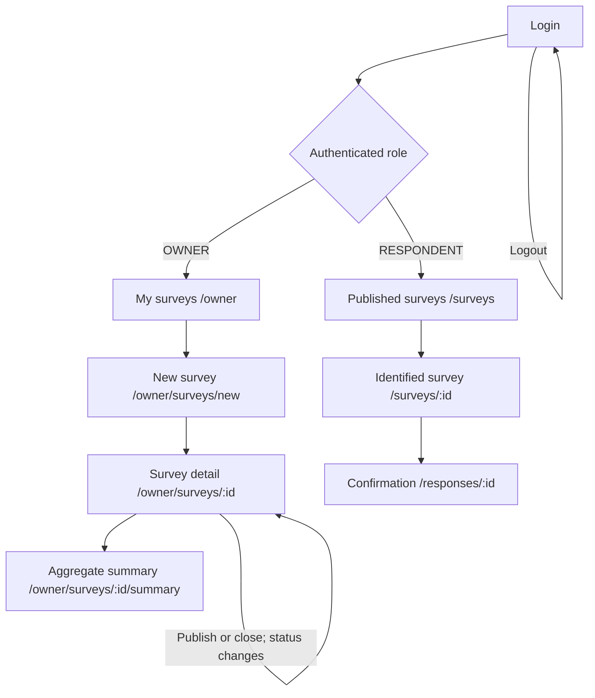

# ClassPulse — System-Level Software Design Specification

**Version:** 1.1 · **Owner:** Student B (`book6349`) · **Issue:** #3 · **Date:** 6 Nov 2026
**Scope:** Part C of Deliverable 1; Sprint 1 architecture and planned deployment boundary.

This SDS describes the whole ClassPulse system and marks later-sprint elements as planned. The shared source of truth is [`plan.md`](plan.md), especially §§2.4–2.9 and I-03. The approved product decisions are in [`design.md`](design.md). PR #15 has merged the SR-01 schema, migration, seed, API shell, client shell and test harness into `sprint-1-staging`; authentication and the feature routes are implemented by the subsequent Issues in the plan.

## 1. Architecture

ClassPulse is a same-origin React application backed by a JSON API and PostgreSQL. The React client handles presentation and user-experience validation. The Express API is authoritative for authentication, authorization, all business rules, validation and transactions. PostgreSQL stores identity, session, course, survey and response data and enforces relational integrity and the constraints that can be expressed in SQL.

| Layer | Technology | Responsibility and reason |
|---|---|---|
| Web client | React 18, TypeScript 5.7, React Router 6, Bootstrap 5.3 | Screens, navigation, accessible forms and feedback. This reuses the team's TokTickIT client skills. Client checks improve feedback but never authorize an operation. |
| Development server | Vite 6 | Serves the client on port 5173 and proxies `/api` to Express on port 3000 so development uses the same-origin cookie flow. |
| API | Node.js 22+, Express 4.21, TypeScript 5.7 | JSON endpoints, cookie-session authentication, role and ownership checks, business rules, input validation, transaction boundaries and stable error responses. |
| Data access | Prisma 5.22 | Typed PostgreSQL queries, transactions, schema migrations and seeding. |
| Database | PostgreSQL 16+ | Durable records, foreign keys, unique constraints and the rating-range CHECK constraint. |
| Verification | Vitest 2, Supertest 7, Testing Library, Playwright 1.48 | Unit, API/database and selected browser-journey checks. Tests use the separate `classpulse_test` database. |

The component and environment paths are shown in [`diagrams/architecture.md`](diagrams/architecture.md). In development the browser loads the SPA from Vite and Vite forwards `/api` requests to Express. In production Express serves `client/dist` and the API from the same origin; the browser does not call a separate API host.

## 2. Data model

Sprint 1 uses the following schema from plan §2.4 and `server/prisma/schema.prisma`.

| Model | Fields and constraints | Relationships and invariant |
|---|---|---|
| `User` | `id` PK; `email` unique; `fullName`; `role` (`OWNER` or `RESPONDENT`); `passwordHash`; `isActive` default true; `createdAt` | A user may own courses and surveys, hold sessions, enroll in courses and submit responses. Passwords are never stored as plaintext. |
| `Session` | `id` PK; `tokenHash` unique; `userId` FK; `createdAt`; `expiresAt`; index on `userId` | The raw cookie token is not stored. User deletion cascades to sessions. |
| `Course` | `id` PK; `code` unique; `title`; `ownerId` FK | The owner is the lecturer. A course has enrollments and surveys. |
| `Enrollment` | `id` PK; `courseId` FK; `userId` FK; unique `(courseId, userId)` | This is the source of respondent eligibility. |
| `Survey` | `id` PK; `courseId` FK; `ownerId` FK; `title`; optional `description`; `mode` (`IDENTIFIED`); `status` (`DRAFT`, `PUBLISHED`, `CLOSED`), default `DRAFT`; optional `publishedAt`, `closedAt`; `createdAt`, `updatedAt` | `ownerId` must match the course owner (BR-08); the API checks it. A survey contains questions and responses. |
| `Question` | `id` PK; `surveyId` FK; `position`; `prompt`; `type` (`RATING` or `SINGLE_CHOICE`); `required` default true; unique `(surveyId, position)` | Deleting a survey cascades to its questions. A question has options and answers. |
| `QuestionOption` | `id` PK; `questionId` FK; `position`; `label`; unique `(questionId, position)` | Deleting a question cascades to its options. |
| `Response` | `id` PK; `surveyId` FK; `respondentId` FK; `submittedAt` default now; unique `(surveyId, respondentId)` | Enforces at most one response per respondent per survey, including concurrent attempts (BR-06). |
| `Answer` | `id` PK; `responseId` FK; `questionId` FK; optional `ratingValue` (SQL column `rating_value`); optional `optionId` FK; unique `(responseId, questionId)` | Deleting a response cascades to its answers. `rating_value IS NULL OR rating_value BETWEEN 1 AND 5` is added to the Prisma migration SQL as `answer_rating_range`, because Prisma 5 does not model this CHECK. |

The ER diagram, including the ownership links `Survey.ownerId` and `Response.respondentId`, is [`diagrams/er.md`](diagrams/er.md). Cross-record and type-dependent rules remain API responsibilities: for example, a survey's owner must own its course, a choice answer must refer to an option belonging to its question, and a rating answer must be in range. The database also enforces foreign keys, uniqueness, cascades noted above and the rating CHECK.

### Seed and migration lifecycle

The deterministic seed creates two owners, three respondents, two courses and three enrollments from the §2.4 fixture. It hashes the synthetic `SEED_PASSWORD`; the development seed additionally creates the CLOSED `Week 1 pulse` survey. `seedFixture()` creates the fixture without that development-only survey. Never commit real passwords or copied `.env` files.

For local development, run `npm run prisma:migrate` and `npm run prisma:seed` from `server/`. Use `prisma migrate deploy` against the explicitly configured test database and at deployment; test setup must point only to `classpulse_test`. `migrate dev` is for authoring a development migration, not for production deployment.

Sprint 2/3 additions are planned, not part of this schema: `Survey.closesAt`, `Section`, `ParticipationRecord`, and `AnonymousResponse`. The anonymous response design has **no user foreign key**. Their exact schemas require the corresponding later-sprint contracts.

## 3. User interface and navigation

The Sprint 1 screen inventory comes from plan §2.7. Every screen uses the Pulse tokens and components from §2.9: paper background, navy ink, coral accent, heartbeat-line motif and accessible five-value rating control.

| Route | Role | Purpose |
|---|---|---|
| `/login` | Public | Email/password form and error alert. |
| `/owner` | `OWNER` | Own surveys, course, status, response count and New survey action. |
| `/owner/surveys/new` | `OWNER` | Choose an owned course and enter title, optional description, and RATING or SINGLE_CHOICE questions. |
| `/owner/surveys/:id` | `OWNER` | Survey detail with Publish/Close actions allowed by current status and a summary link. |
| `/owner/surveys/:id/summary` | `OWNER` | Aggregate counts, rating averages/distributions and choice counts; empty state when there are no responses. |
| `/surveys` | `RESPONDENT` | Published surveys from enrolled courses and a Submitted badge when answered. |
| `/surveys/:id` | `RESPONDENT` | Identified-survey notice and answer form. |
| `/responses/:id` | `RESPONDENT` | Submission confirmation, timestamp and the respondent's own answers. |

Shared states are consistent across forms and lists: show `PulseLine` during fetches; clear empty-state copy for empty lists or summaries; show `ApiClientError.message` in an alert; place field-level `details` below the matching input; disable submit/action buttons while a request is in flight. A failed request leaves the user on the current screen with a recoverable error. The navigation guard improves UX only; the API still checks every request.

## 4. API conventions

Every endpoint is under `/api` and uses JSON. Path IDs are positive decimal integers. The API returns `{ user: { id, email, fullName, role } }` without `passwordHash`; it does not return stack traces. The table below is the Sprint 1 contract from plan §2.5.

| Method and path | Access | Request | Success |
|---|---|---|---|
| `GET /api/health` | Public | — | `200 {"status":"ok"}` |
| `POST /api/auth/login` | Public | `{email, password}` | `200 {user}` and `cp_session` cookie |
| `POST /api/auth/logout` | Authenticated | — | `204`; session row deleted and cookie cleared |
| `GET /api/auth/me` | Authenticated | — | `200 {user}` for the current session |
| `GET /api/owner/courses` | Owner | — | `200 {courses:[{id,code,title}]}` for owned courses |
| `GET /api/owner/surveys` | Owner | — | `200 {surveys:[{id,title,status,courseCode,responseCount}]}` for owned surveys |
| `POST /api/owner/surveys` | Owner | `{courseId,title,description?,questions:[...]}` | `201 {survey}` in `DRAFT` |
| `GET /api/owner/surveys/:id` | Owner | — | `200 {survey}` with questions and options |
| `POST /api/owner/surveys/:id/publish` | Owner | — | `200 {survey}` in `PUBLISHED`, with `publishedAt` |
| `POST /api/owner/surveys/:id/close` | Owner | — | `200 {survey}` in `CLOSED`, with `closedAt` |
| `GET /api/owner/surveys/:id/summary` | Owner | — | `200 {summary}` with aggregate results |
| `GET /api/surveys` | Respondent | — | `200 {surveys:[...]}` for published surveys in enrolled courses |
| `GET /api/surveys/:id` | Respondent | — | `200 {survey}` with questions; `404` if not published or not enrolled |
| `POST /api/surveys/:id/responses` | Respondent | `{answers:[...]}` | `201 {response:{id,surveyId,submittedAt}}` |
| `GET /api/responses/:id` | Respondent | — | `200` own response with answers; `404` for another respondent's response |

Protected-route processing order is **401 unauthenticated → 403 wrong role → 404 missing or not owned → business-rule checks → 400 field validation → persistence**. For `POST /api/surveys/:id/responses`, first resolve the numeric survey ID and return 404 if the survey does not exist; then check enrollment (403 `NOT_ELIGIBLE`), survey status (409 `SURVEY_NOT_OPEN` for DRAFT or CLOSED), answer fields (400 `VALIDATION_ERROR`), and only then persist. The respondent detail route remains 404 for an unpublished survey or a respondent who is not enrolled, as specified in §2.5. Use consistent error JSON `{error:{code,message,details?}}`:

| Code | HTTP | Meaning |
|---|---:|---|
| `VALIDATION_ERROR` | 400 | Malformed JSON or invalid fields; `details[]` identifies invalid fields. |
| `INVALID_CREDENTIALS` | 401 | Unknown email, wrong password or inactive account; message is the same. |
| `UNAUTHENTICATED` | 401 | Missing, expired or invalid session. |
| `FORBIDDEN` | 403 | Authenticated user has the wrong role for the route. |
| `NOT_ELIGIBLE` | 403 | Respondent is not enrolled in the survey course. |
| `NOT_FOUND` | 404 | Missing, non-numeric ID or resource not owned by the caller. |
| `INVALID_TRANSITION` | 409 | Requested survey status change violates BR-03. |
| `SURVEY_NOT_OPEN` | 409 | Response submitted to a DRAFT or CLOSED survey. |
| `ALREADY_RESPONDED` | 409 | Unique `(surveyId, respondentId)` constraint rejected a duplicate. |

## 5. Role and permission matrix

“Own” is always evaluated on the server from the authenticated identity and stored relationships. The owner sees aggregates only in Sprint 1; the respondent can read only their own response.

| Operation | Anonymous | Respondent | Owner |
|---|---|---|---|
| Login | Public | Public | Public |
| `/me` / logout | Rejected: 401 | Own session | Own session |
| List own courses | 401 | 403 | Own courses only |
| List/create/publish/close survey | 401 | 403 | Own courses/surveys only; otherwise 404 |
| Read own survey detail | 401 | 403 | Own surveys only; otherwise 404 |
| View summary | 401 | 403 | Own surveys only; otherwise 404 |
| List published surveys | 401 | Enrolled courses only | 403 |
| Read published survey detail | 401 | Enrolled + PUBLISHED; otherwise 404 | 403 |
| Submit response | 401 | Existing survey → enrollment 403 → status 409 → fields 400; once | 403 |
| Read a response | 401 | Own response only; otherwise 404 | 403; aggregates only in Sprint 1 |

A hidden frontend control is not authorization; every cell is enforced in `server/src/middleware/auth.ts` plus route handlers and tested.

## 6. Authentication and session flow

1. Login looks up the account and verifies its password with `node:crypto` scrypt using a 16-byte salt. The stored representation is `salt:hash`. Unknown email, wrong password and inactive user all receive the same `401 INVALID_CREDENTIALS` response.
2. After successful verification, the API creates a 32-byte cryptographically random token, sends it only in the `cp_session` HttpOnly, SameSite=Lax cookie, and stores only its SHA-256 hash in `Session.tokenHash`. The raw token is never written to logs or the database.
3. `requireAuth` hashes the presented cookie and looks up a live session; expired, missing, invalid, or belonging to an inactive user sessions receive `401 UNAUTHENTICATED`. The session lookup treats an inactive user as having no valid session, even if that user's session row has not yet expired. It attaches the authenticated `AuthUser` to the request. `requireRole` returns `403 FORBIDDEN` for a role mismatch. Resource lookups apply owner/respondent filters and return 404 for records the caller must not discover.
4. `/api/auth/me` returns the current public user fields. Logout deletes that session row and clears the cookie, so replaying the old cookie fails immediately.

`SESSION_TTL_HOURS` configures the session lifetime (8 hours in Sprint 1). The `cp_session` cookie has `Secure` set when `NODE_ENV=production` and not set in development or test; production must use HTTPS. The client `AuthProvider` requests `/api/auth/me` on load; the client route guard is not a substitute for backend middleware.

## 7. Configuration and deployment

All configuration is supplied through environment variables; `.env` and `.env.test` are local-only and ignored by Git. Commit examples only. Tests must use the separate `classpulse_test` database.

| Variable | Use |
|---|---|
| `DATABASE_URL` | PostgreSQL connection for the selected environment; development and test use different database names. |
| `PORT` | Express listen port; local default is `3000`. |
| `SESSION_TTL_HOURS` | Server-side session lifetime; Sprint 1 is 8 hours. |
| `SEED_PASSWORD` | Synthetic password used by deterministic seeds; never commit its value. |
| `NODE_ENV` | Runtime environment (`development`, `test` or `production`). |

The current local workflow is documented in [`README.md`](../README.md): install locked dependencies, copy `server/.env.example` and `server/.env.test.example`, migrate/seed development, deploy the same migration to the test database, and run the API and Vite client. Keep passwords synthetic and ensure tests cannot reset the development database.

Cloud deployment is planned for Lab 5, outside the Sprint 1 build: one Docker image containing the Express API and `client/dist` on Cloud Run, PostgreSQL on Cloud SQL, credentials in Secret Manager, and images in Artifact Registry. Apply committed migrations with `prisma migrate deploy` at release. Persist state in Cloud SQL; do not rely on a Cloud Run container's local disk. Use HTTPS and the Secure session-cookie setting in production.

## Version history

| Version | Change | Reason |
|---|---|---|
| 1.1 | Clarified response endpoint check order, inactive-session handling, and production cookie security; split the role matrix by operation and named the PulseLine loading state. | Addressed the review on PR #16 and aligned the SDS with plan §§2.5/2.9 and F-01 §3. |
